# Thiết kế lại kiến trúc & Kế hoạch triển khai 6 tuần
**Đề tài:** Nền tảng Web SaaS phân phối vé, merchandise và sàn resale — Microservices, High Concurrency, Blockchain, AI
**Phiên bản:** v2.1 (thiết kế để implement, đã chốt các lựa chọn của nhóm) · **Nhóm:** 3 thành viên · **Thời gian:** 6 tuần

> Tài liệu dựa trên: Mô tả bài toán, Phân tích yêu cầu, Đặc tả Use Case (UC-01..UC-16), Phân tích nghiệp vụ và Kiến trúc v1 của nhóm. Các con số hiệu năng trong tài liệu là **mục tiêu đề xuất để đo và hiệu chỉnh**, không phải kết quả đã đo.

---

## Các quyết định đã chốt (v2.1)

| Hạng mục | Quyết định | Hệ quả lên thiết kế |
|---|---|---|
| Máy chủ demo | **8–16 GB RAM** | Bỏ phương án cắt giảm cho 4 GB; dùng được Jaeger/Loki. Nên chạy k6 từ máy khác để không tranh CPU với hệ thống đang đo |
| API Gateway | **Kong (DB-less)** | Bỏ Traefik/Nginx khỏi thiết kế |
| Sandbox thanh toán | **VNPay sandbox** làm cổng thật; **adapter mock** để test tải; MoMo là tùy chọn nếu còn thời gian | Xem mục 10.1 |
| Offline check-in | **Phương án A** (gói xác thực mã hóa theo vé) | Xem mục 6.1 |
| AI | **Làm sau**, ngoài phạm vi 6 tuần | Bỏ khỏi kế hoạch; giữ sẵn điểm mở rộng để gắn vào không phải sửa lõi (mục 11.5) |

---

## 0. Tóm tắt các quyết định chính

| # | Quyết định | Lý do ngắn gọn |
|---|---|---|
| 1 | Rút từ 12 service xuống **9 service nghiệp vụ + 1 gateway** (thêm `ai-service` ở giai đoạn sau); gộp Blockchain vào `ticket-service` dưới dạng worker bất đồng bộ | Team 3 người / 6 tuần. Mint NFT là tác vụ async, dữ liệu (tx hash) thuộc về vé |
| 2 | **Database-per-service thật sự**: mỗi service có DB riêng, không JOIN/FK chéo DB | Yêu cầu của bạn; cũng là điểm ăn tiền khi bảo vệ |
| 3 | Chống oversell theo **phòng thủ nhiều lớp**: Waiting Room → Redis Lua (atomic) → PostgreSQL unique index | Redis nhanh nhưng không phải nguồn sự thật; DB là chốt chặn cuối |
| 4 | Giao dịch phân tán bằng **Saga + Transactional Outbox + Inbox (idempotent consumer)** | Kafka là at-least-once, phải chịu được message trùng/mất thứ tự |
| 5 | `booking-service` **không gọi sync** sang `event-service` lúc flash sale; dùng read-model (`event_snapshots`) đồng bộ qua Kafka | Cô lập lỗi, bỏ một hop trên đường nóng |
| 6 | Thay MongoDB bằng **PostgreSQL + pgvector** cho AI; thay ELK bằng **Loki**; bỏ **PM2**, bỏ Nginx trùng chức năng với Kong, gRPC chỉ là tùy chọn | Giảm số công nghệ, giảm RAM, giảm chi phí học |
| 7 | Sửa thiết kế **offline check-in**: "preload danh sách hash vé" không đủ để verify TOTP offline (xem mục 6) | Lỗi kỹ thuật cần xử lý trước khi code |
| 8 | Deploy ở mức product: domain + HTTPS + CI/CD + monitoring + backup + load-test report | Phù hợp tiêu chí chấm trong `datn.md` |

---

## 1. Đánh giá Kiến trúc v1 và điều chỉnh

| Vấn đề trong v1 | Hậu quả | Điều chỉnh trong v2 |
|---|---|---|
| 1 PostgreSQL instance, 12 schema | Không phải database-per-service; coupling ở tầng dữ liệu | Mỗi service một database + user riêng. Xem mục 5.0 về cách triển khai |
| Khóa ghế bằng `SETNX` từng ghế | Chọn nhiều ghế không atomic → khóa dở dang, deadlock logic | Lua script all-or-nothing (mục 3.4) |
| Redis lock là chốt chặn duy nhất | Redis restart/failover → có thể bán trùng | Thêm partial unique index trong PostgreSQL (mục 3.5) |
| Webhook thanh toán → publish Kafka trực tiếp | Ghi DB thành công nhưng publish lỗi (hoặc ngược lại) → vé không được phát hành | Transactional Outbox (mục 3.6) |
| Kafka at-least-once nhưng chưa nói consumer idempotent | Phát hành vé 2 lần, trừ kho 2 lần | Bảng `processed_events` (Inbox) ở mọi consumer |
| Booking gọi gRPC sang Ticket/Event trên đường nóng | Một service chậm kéo sập luồng đặt vé | Read-model + event; sync call chỉ cho thao tác ít |
| Offline check-in bằng "hash vé" | Hash không sinh được mã TOTP → không verify được offline | Gói xác thực mã hóa theo vé (mục 6) |
| MongoDB chỉ để lưu vector/FAQ | Thêm 1 công nghệ, 1 container, không cần thiết | pgvector trong `ai_db` |
| ELK, PM2 trong container, Nginx + Kong cùng lúc | Ngốn RAM / chồng chéo | Loki + Promtail; Docker restart policy + replicas; chỉ Kong |
| Chưa có Waiting Room dù UC-07 A4 yêu cầu | Flash sale đổ thẳng vào booking | Virtual Waiting Room (mục 3.3) |
| Chưa có chiến lược chứng minh hiệu năng | Khó thuyết phục hội đồng | Kịch bản k6 + script kiểm tra oversell = 0 (mục 3.10) |

---

## 2. Kiến trúc đích

### 2.1 Sơ đồ tổng thể

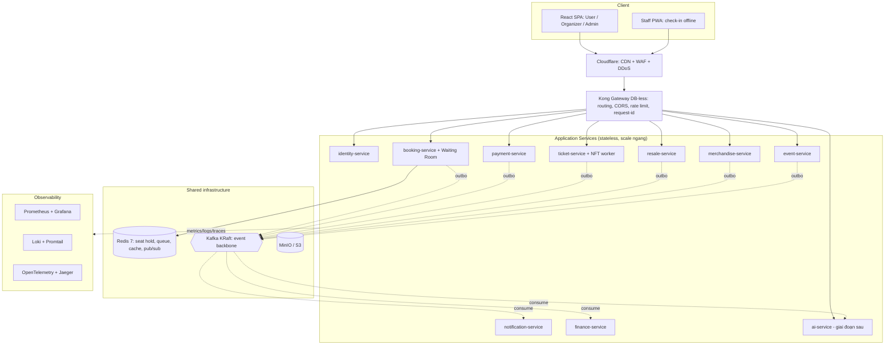

### 2.2 Danh sách service (rút gọn có chủ đích)

| Service | Trách nhiệm | DB riêng | Runtime | Mức ưu tiên |
|---|---|---|---|---|
| `identity-service` | Đăng ký/đăng nhập, Google OAuth, JWT RS256 + JWKS, RBAC, KYC (CCCD mã hóa), duyệt Organizer | `identity_db` (PG) | NestJS | Must |
| `event-service` | Event, venue, seat map (Zone→Block→Row→Seat), hạng vé, sale phase, duyệt sự kiện | `event_db` (PG) | NestJS | Must |
| `booking-service` | Waiting Room, giữ ghế (Redis Lua), giỏ hàng, order, saga điều phối, voucher | `booking_db` (PG) + Redis | NestJS | Must (lõi) |
| `payment-service` | VNPay adapter (+ mock; MoMo tùy chọn), webhook IPN, idempotency, reconciliation, refund đơn/lô | `payment_db` (PG) | NestJS | Must |
| `ticket-service` | Phát hành vé, TOTP, QR, ví vé, check-in online/offline, sync, **NFT worker** | `ticket_db` (PG) | NestJS | Must |
| `merchandise-service` | Sản phẩm/SKU, tồn kho, reserve/commit/release, combo, cảnh báo hết hàng | `merch_db` (PG) | NestJS | Must |
| `resale-service` | Niêm yết (trần 120%), escrow, chuyển quyền, tranh chấp | `resale_db` (PG) | NestJS | Should |
| `notification-service` | Email/SMS/Push/In-app, campaign (consumer thuần) | `notification_db` (PG) | NestJS | Should |
| `finance-service` | Sổ cái, tách doanh thu vé/merch (VAT), payout, hóa đơn điện tử, audit log append-only | `finance_db` (PG) | NestJS | Should |
| `ai-service` | Recommender (TF-IDF + cosine + co-purchase), Chatbot RAG | `ai_db` (PG + pgvector) | FastAPI | Giai đoạn sau |

**Nguyên tắc ràng buộc cho toàn bộ service**
1. Chỉ service chủ sở hữu mới đọc/ghi DB của mình. Tham chiếu chéo service chỉ bằng ID, không FK.
2. Mọi thay đổi trạng thái quan trọng đi kèm một dòng `outbox_events` **trong cùng transaction**.
3. Mọi consumer Kafka kiểm tra `processed_events` trước khi xử lý.
4. Mọi API ghi có `Idempotency-Key`.
5. Dữ liệu đa tenant: mọi bảng liên quan Organizer có cột `organizer_id`; gateway gắn `X-Tenant-Id` từ JWT, service kiểm tra lại.
6. Tiền tệ lưu `bigint` đơn vị VND (không dùng số thực). ID dùng UUIDv7 (sắp xếp theo thời gian, tốt cho index).

---

## 3. Giải pháp xử lý High Concurrency (trọng tâm đồ án)

### 3.1 Bài toán và kịch bản kiểm thử

Flash sale: lượng người truy cập lớn cùng lúc, số ghế hữu hạn, mọi người tranh cùng một tập ghế.

Kịch bản chuẩn dùng xuyên suốt khi đo (giả định, chỉnh theo máy thật):

| Kịch bản | Mô tả | Tiêu chí đạt (đề xuất) |
|---|---|---|
| S1 – Tranh ghế | 5.000–10.000 VU, 2.000 ghế, mỗi VU thử giữ ghế ngẫu nhiên | **Oversell = 0**; mỗi ghế tối đa 1 order PAID |
| S2 – Đọc nặng | 10.000 VU xem trang sự kiện + seat map | p95 < 300 ms, phần lớn trả từ cache/CDN |
| S3 – Luồng đầy đủ | 500 VU: hold → order → pay (sandbox mock) → nhận vé | Tỷ lệ lỗi 5xx < 1%, vé phát hành = số order PAID |
| S4 – Chịu lỗi | Kill Redis / Kafka / delay payment giữa S3 | Không mất đơn, không trùng vé, hệ thống tự hồi phục |

### 3.2 Phễu bảo vệ nhiều lớp

| Lớp | Cơ chế | Mục đích |
|---|---|---|
| L0 – Edge | Cloudflare CDN cache trang/ảnh/seat-map tĩnh; WAF; rate limit theo IP | Chặn bot, không để đọc tĩnh chạm backend |
| L1 – Gateway | Kong: routing, CORS, rate limit theo IP, giới hạn kích thước body, request-id. JWT được verify trong từng service bằng `auth-guard` dùng chung (Kong OSS không tự lấy JWKS, xem ADR-0004) | Loại request rác sớm |
| L2 – Waiting Room | Hàng đợi ảo trên Redis ZSET, cấp **admission token** theo tốc độ cố định | Chỉ cho lượng người vừa sức booking vào |
| L3 – Seat Hold | Redis Lua atomic, TTL | Giành ghế nhanh, không chạm DB |
| L4 – Checkout | Transaction PostgreSQL + **partial unique index** | Chốt chặn cuối chống bán trùng |
| L5 – Async | Kafka + outbox/inbox | Tách payment, ticket, merch, notification khỏi đường nóng |
| L6 – Resilience | Circuit breaker, timeout, retry + jitter, load shedding | Một thành phần chậm không kéo sập cả hệ thống |

### 3.3 Virtual Waiting Room (UC-07 A4)

```
POST /queue/join            -> ZADD queue:{eventId} <epoch_ms> <userId>   (NX, mỗi user 1 chỗ)
GET  /queue/status (SSE)    -> vị trí = ZRANK, ước lượng thời gian chờ
Admission worker (mỗi 1s)   -> lấy N user đầu hàng (N = admit_rate), ZREM,
                               cấp admission token: JWT ngắn hạn (ttl 5-10 phút), claim {eventId, userId}
Mọi API /holds, /checkout   -> bắt buộc có admission token hợp lệ (guard trong booking-service)
```

- `admit_rate` cấu hình theo `sale_phases` (ví dụ 200 user / 10 giây) và có thể **tự điều chỉnh** theo p95 của booking (tăng/giảm cộng-nhân, tùy chọn nâng cao).
- Giới hạn mỗi user/CCCD hash tối đa K vé mỗi sự kiện (chống đầu cơ): counter Redis `limit:{eventId}:{kycHash}`.
- Sự kiện "hot" bắt buộc OTP + KYC trước khi vào hàng đợi (đúng yêu cầu 4.1 của bài toán).

### 3.4 Giữ ghế bằng Redis Lua (atomic, all-or-nothing)

Thiết kế key (hash tag để mọi ghế cùng event nằm cùng slot, cho phép Lua đa key nếu sau này dùng Cluster):

| Key | Kiểu | Ý nghĩa |
|---|---|---|
| `seat:{evt:ID}:<seatId>` | String | `H:<holderId>` (đang giữ, có TTL) hoặc `S` (đã bán, không TTL) |
| `hold:{evt:ID}:<holderId>` | Set | Danh sách ghế của người giữ (để release/extend nhanh) |
| `stock:{evt:ID}:<classId>` | Integer | Số vé còn lại cho hạng vé GA (không đánh số ghế) |
| `queue:{evt:ID}` | ZSET | Hàng đợi |
| `limit:{evt:ID}:<kycHash>` | Integer | Số vé đã mua/đang giữ |

```lua
-- hold_seats.lua
-- KEYS = danh sách seat key; ARGV[1] = 'H:'..holderId ; ARGV[2] = ttl giây
for i = 1, #KEYS do
  local v = redis.call('GET', KEYS[i])
  if v and v ~= ARGV[1] then
    return {0, KEYS[i]}            -- xung đột: trả về ghế bị giữ/đã bán
  end
end
for i = 1, #KEYS do
  redis.call('SET', KEYS[i], ARGV[1], 'EX', tonumber(ARGV[2]))
end
return {1}

-- release_seats.lua: chỉ xóa nếu value == holder (tránh nhả nhầm ghế người khác)
for i = 1, #KEYS do
  if redis.call('GET', KEYS[i]) == ARGV[1] then redis.call('DEL', KEYS[i]) end
end
return 1
```

- Không dùng `SETNX` lặp trong code ứng dụng; Lua đảm bảo kiểm tra + đặt là một thao tác nguyên tử.
- TTL giữ ghế 10 phút; khi tạo order được gia hạn **một lần** lên cửa sổ thanh toán (15 phút).
- Redis chạy Sentinel (1 primary + 1 replica) để chịu lỗi. Mở rộng sau này: Redis Cluster, shard theo block (hạn chế: một lần giữ ghế chỉ trong cùng block/slot).
- Khởi động lại Redis: job **rehydrate** dựng lại `seat:*` từ `seat_allocations` (HELD chưa hết hạn, SOLD) trước khi mở bán.

### 3.5 Zero Oversell: Redis là cửa nhanh, PostgreSQL là sự thật

```sql
-- booking_db: không cho phép 2 allocation "còn hiệu lực" cho cùng 1 ghế
CREATE UNIQUE INDEX uq_seat_active
  ON seat_allocations (event_id, seat_id)
  WHERE state IN ('HELD','SOLD');
```

Checkout tạo `orders` + `order_items` + `seat_allocations(HELD)` **trong một transaction**. Nếu Redis mất dữ liệu và hai người cùng qua cửa Redis, người thứ hai sẽ vi phạm unique index → trả "ghế không khả dụng" và release hold. Xác nhận thanh toán đổi `HELD → SOLD` bằng cập nhật có điều kiện (`WHERE state='HELD' AND order_id=:id`), kiểm tra `expires_at` bằng thời gian DB.

Với vé GA (không số ghế): `UPDATE ticket_class_stock SET sold = sold + :q WHERE class_id=:id AND sold + :q <= total` — một câu lệnh atomic, trả về 0 dòng nghĩa là hết vé.

### 3.6 Saga checkout + Transactional Outbox

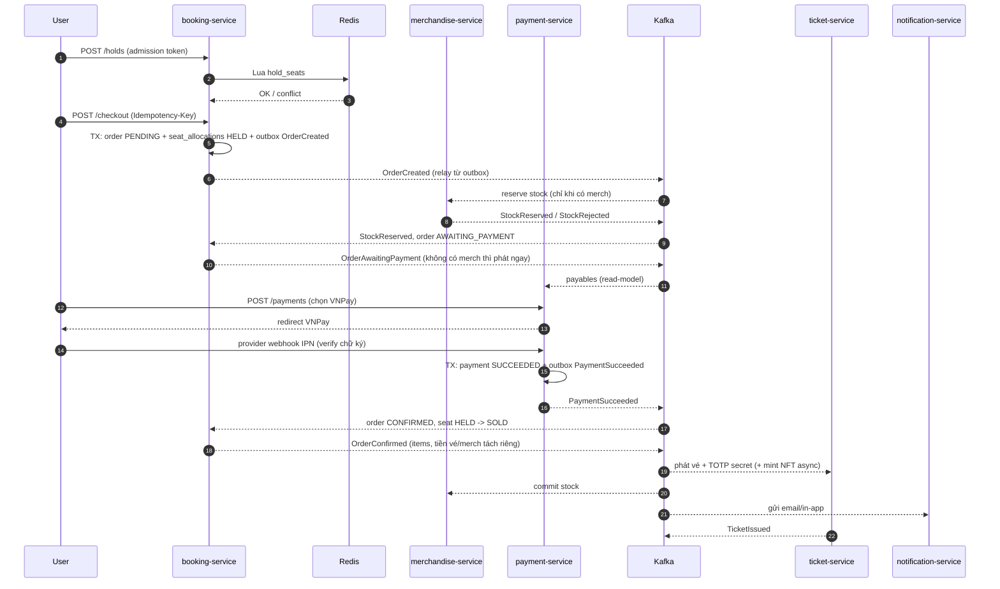

**Đường bù (compensation):** `PaymentFailed` không hủy order (khách được thanh toán lại đến khi hết hạn, ADR-0009 D7). `OrderExpired`, `StockRejected` → `booking-service` đưa order sang EXPIRED/CANCELLED, nhả ghế (Lua release + `seat_allocations.state=RELEASED`), phát `OrderExpired`/`OrderCancelled` để `merchandise-service` release stock. **Thanh toán đến muộn:** order → `REFUND_REQUIRED` → `OrderCancelled{LATE_PAYMENT}` → payment tự hoàn tiền → `REFUNDED` (không hồi sinh order).

**Máy trạng thái order** (chi tiết ADR-0009): `PENDING → AWAITING_PAYMENT → CONFIRMED → REFUNDED`; nhánh phụ `→ EXPIRED | FAILED | CANCELLED → REFUND_REQUIRED → REFUNDED`. Mọi chuyển trạng thái là cập nhật có điều kiện theo `status` và `version`.

**Outbox & Inbox**

```sql
CREATE TABLE outbox_events (
  id uuid PRIMARY KEY, aggregate_type text, aggregate_id text,
  event_type text, payload jsonb, headers jsonb,
  created_at timestamptz DEFAULT now(), published_at timestamptz
);
-- Relay: SELECT ... WHERE published_at IS NULL ORDER BY created_at
--        FOR UPDATE SKIP LOCKED LIMIT 100  -> publish -> UPDATE published_at

CREATE TABLE processed_events (
  event_id uuid, consumer text, processed_at timestamptz DEFAULT now(),
  PRIMARY KEY (event_id, consumer)
);
-- Consumer: INSERT ... ON CONFLICT DO NOTHING; nếu 0 dòng => đã xử lý, bỏ qua
```

Bản đầu dùng polling relay (đơn giản, đủ cho đồ án). Debezium là tùy chọn nâng cao nếu còn thời gian.

**Hết hạn order:** `expires_at` trong DB + sweeper định kỳ (`FOR UPDATE SKIP LOCKED`) quét order quá hạn → phát `OrderExpired`. Không dựa vào Redis keyspace notification (không đảm bảo giao).

### 3.7 Tồn kho merchandise

- Hàng "hot" (lightstick…): Redis counter `merch:stock:<skuId>` làm cửa nhanh, `inventory` trong `merch_db` là sự thật.
- Quy trình **reserve → commit/release** với `stock_reservations` (unique `order_id, sku_id`) để idempotent:
  `UPDATE inventory SET reserved = reserved + :q WHERE sku_id=:id AND on_hand - reserved >= :q`.
- Mọi biến động ghi vào `stock_movements` (append-only) để đối soát; hết hạn reservation tự release.
- Dưới ngưỡng `low_stock_threshold` → phát `StockLow` → notification cho Organizer.

### 3.8 Seat map realtime không làm "bão" băng thông

- Cấu trúc seat map (layout JSON, bất biến theo `version`) → CDN/Redis cache, client tải một lần.
- Trạng thái ghế: client nhận **bản chụp ban đầu** (bitmap/mảng ngắn) rồi nhận **delta gộp theo lô 500 ms–1 s** qua Socket.IO (Redis adapter) hoặc SSE. Không broadcast từng ghế một.
- Khi hàng đợi chạy, chỉ người đã có admission token mới subscribe kênh trạng thái ghế.

### 3.9 Mẫu chịu lỗi và co giãn

| Mẫu | Áp dụng |
|---|---|
| Timeout + retry (backoff + jitter) | Mọi call ra ngoài (payment provider, Pinata, RPC blockchain) |
| Circuit breaker (`opossum`) | Payment provider, MISA, blockchain RPC |
| Bulkhead | Pool kết nối/worker tách riêng cho đường nóng (booking) và job nền |
| Load shedding / degradation | Khi flash sale: tắt recommender, hạn chế chatbot, trả cache cũ cho danh sách |
| Cache-aside + chống stampede | Mutex theo key + TTL ngẫu nhiên cho trang sự kiện |
| Connection pooling | **PgBouncer** (transaction mode) trước PostgreSQL của booking/payment |
| Scale ngang | Service stateless; `docker compose --scale booking=3` sau Kong (K8s HPA nếu dùng k3s) |
| Dead-letter | Topic `*.dlq` + màn hình Admin xem/replay |
| Reconciliation | Payment đối soát provider mỗi 5 phút; ticket đối soát với order PAID |

### 3.10 Cách chứng minh (đưa vào báo cáo)

1. **k6** viết kịch bản S1–S4, xuất dashboard Grafana (RPS, p50/p95/p99, lỗi, Kafka consumer lag, Redis ops/s, kết nối DB).
2. **Script kiểm tra tính đúng đắn sau test** (chạy trên DB):
   ```sql
   -- Phải trả về 0 dòng
   SELECT event_id, seat_id, count(*) FROM seat_allocations
   WHERE state='SOLD' GROUP BY 1,2 HAVING count(*) > 1;
   -- Phải bằng nhau
   SELECT count(*) FROM orders WHERE status='CONFIRMED';  -- booking_db
   SELECT count(DISTINCT order_id) FROM tickets;           -- ticket_db
   ```
3. Hai vòng đo: trước tối ưu (baseline) và sau tối ưu; ghi rõ cấu hình máy, số replica, số liệu, nút cổ chai tìm được và cách xử lý.
4. Chaos test: dừng Redis/Kafka/payment trễ trong lúc chạy S3, ghi lại hành vi và thời gian hồi phục.

---

## 4. Giao tiếp giữa service và Event Contract

- **Sync (REST, qua Kong):** client ↔ service; service ↔ service chỉ cho thao tác ít và không nằm trên đường nóng (ví dụ resale đóng băng vé qua `ticket-service`). gRPC là tùy chọn, **không bắt buộc**.
- **Async (Kafka):** mọi thay đổi trạng thái xuyên service.
- **Realtime:** Socket.IO/SSE + Redis pub/sub.

**Envelope chung**
```json
{
  "event_id": "uuid-v7",
  "type": "PaymentSucceeded",
  "version": 1,
  "occurred_at": "2026-10-06T10:00:00Z",
  "trace_id": "...",
  "tenant_id": "organizer-uuid",
  "data": { }
}
```

| Topic | Key (partition) | Producer | Consumer | Sự kiện chính |
|---|---|---|---|---|
| `event.lifecycle` | `event_id` | event | booking, ai, merch, finance | EventApproved, EventUpdated, EventCancelled, SalePhaseChanged |
| `booking.orders` | `order_id` | booking | payment, merch, notification, finance | OrderCreated, OrderConfirmed, OrderExpired, OrderCancelled |
| `merch.stock` | `sku_id` | merch | booking, notification | StockReserved, StockRejected, StockCommitted, StockLow |
| `payment.events` | `order_id` | payment | booking, ticket, finance, resale | PaymentSucceeded, PaymentFailed, RefundCompleted |
| `ticket.events` | `ticket_id` | ticket | notification, finance, resale | TicketIssued, TicketTransferred, TicketRevoked, TicketCheckedIn |
| `resale.events` | `listing_id` | resale | ticket, finance, notification | ListingCreated, ListingCancelled, ResaleCompleted |
| `audit.events` | `resource_id` | tất cả | finance | AuditRecorded |
| `*.dlq` | theo topic gốc | — | admin tool | Message lỗi sau N lần retry |

Quy ước: số partition mặc định 6 cho topic nóng (`booking.orders`, `payment.events`), 3 cho phần còn lại; thứ tự đảm bảo **trong cùng key**; consumer không giả định thứ tự giữa các key; schema thay đổi theo hướng tương thích ngược (thêm field, tăng `version`).

---

## 5. Thiết kế cơ sở dữ liệu — mỗi service một DB

### 5.0 Sơ đồ ánh xạ service ↔ database

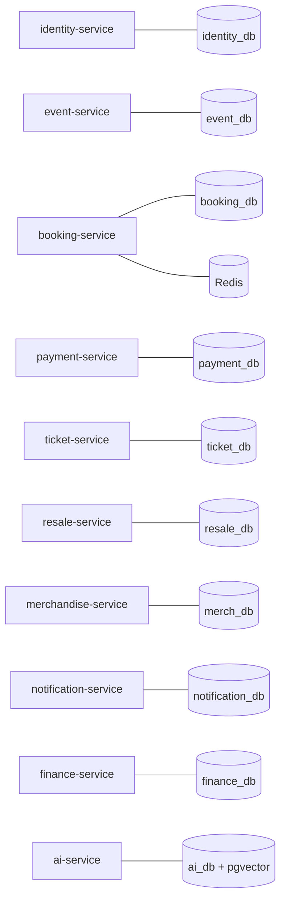

**Quy tắc dữ liệu chung**
- Không FK, không JOIN, không view chéo DB. Trường tham chiếu ngoài ghi chú `ref:<db>`.
- Dữ liệu cần từ service khác → sao chép **read-model** qua event (ví dụ `event_snapshots`).
- Mỗi DB có `outbox_events` và `processed_events` (không vẽ lại ở từng sơ đồ).
- Mọi bảng có `created_at timestamptz`; bảng thay đổi nhiều có `updated_at` và `version` (optimistic lock).
- Dữ liệu định danh (CCCD, địa chỉ nhận hàng) mã hóa **AES-256-GCM ở tầng ứng dụng**, lưu `key_id` để xoay khóa; cột tra cứu dùng `HMAC-SHA256` có pepper.
- **Triển khai:** mỗi service dùng một *database* và một *user* riêng không có quyền sang DB khác. Dev: có thể chạy chung một PostgreSQL server để tiết kiệm RAM (vẫn tách database/user). Demo/production: tách container riêng ít nhất cho `booking_db`, `payment_db`, `ticket_db` (các DB nóng/quan trọng); các DB còn lại gộp server nếu thiếu tài nguyên. Nêu rõ điều này trong báo cáo thay vì nói "12 server".

### 5.1 identity_db

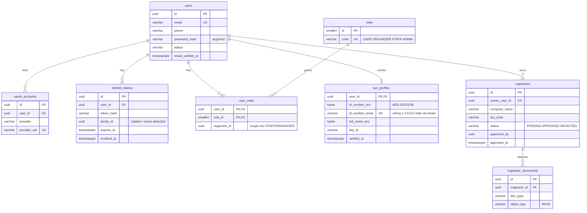
Ghi chú: `otp_requests(id, target, purpose, code_hash, expires_at, attempts)` đặt ở Redis (TTL) thay vì bảng.

### 5.2 event_db

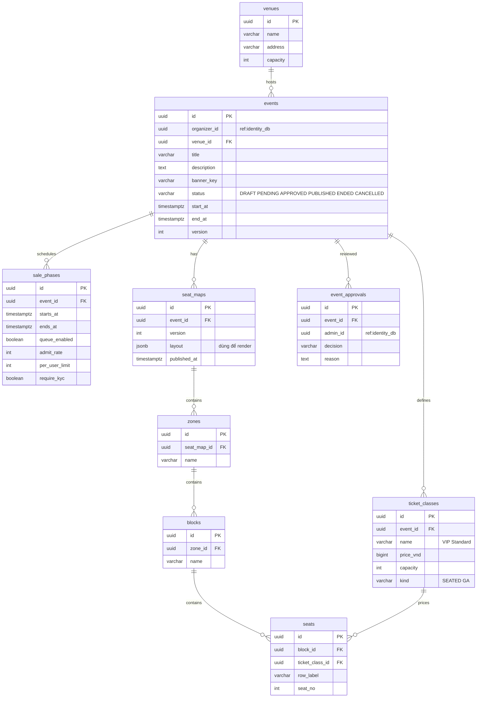
Seat map đã `published` là **bất biến**; sửa = tạo `version` mới (chỉ cho phép trước khi mở bán).

### 5.3 booking_db (DB nóng nhất)

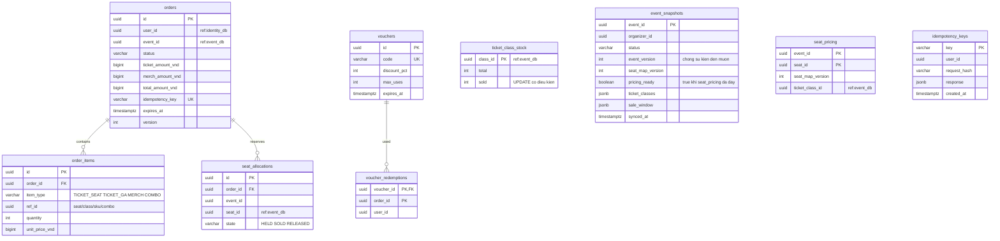
Index quan trọng: partial unique `uq_seat_active (event_id, seat_id) WHERE state IN ('HELD','SOLD')`; `orders(status, expires_at)` cho sweeper; `orders(user_id, created_at desc)`.

### 5.4 payment_db

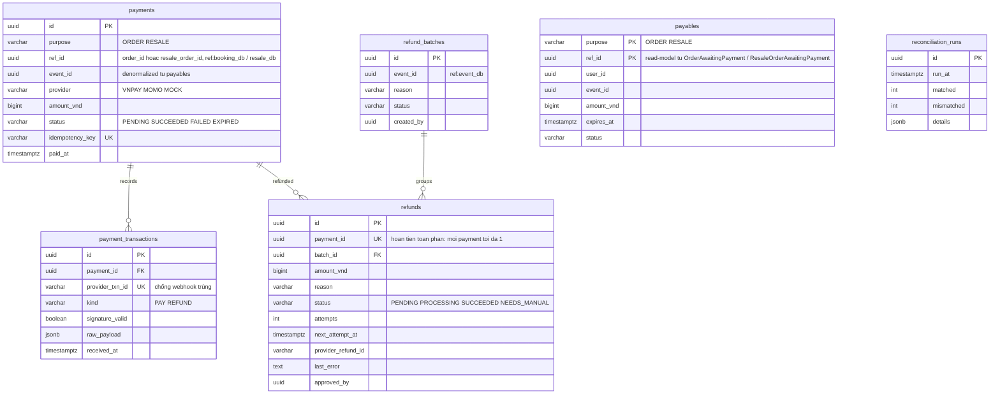
Không lưu số thẻ/thông tin thanh toán nhạy cảm (chuyển hướng sang cổng → phạm vi PCI-DSS thu hẹp).

### 5.5 ticket_db

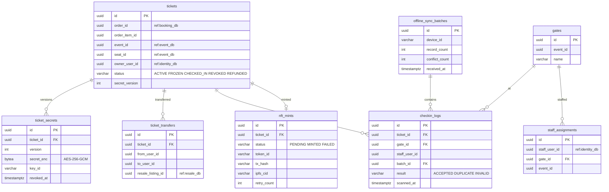
Chống check-in trùng online: `CREATE UNIQUE INDEX uq_checkin_accepted ON checkin_logs(ticket_id) WHERE result='ACCEPTED';`. `checkin_logs` là append-only (revoke UPDATE/DELETE cho user ứng dụng).

### 5.6 resale_db

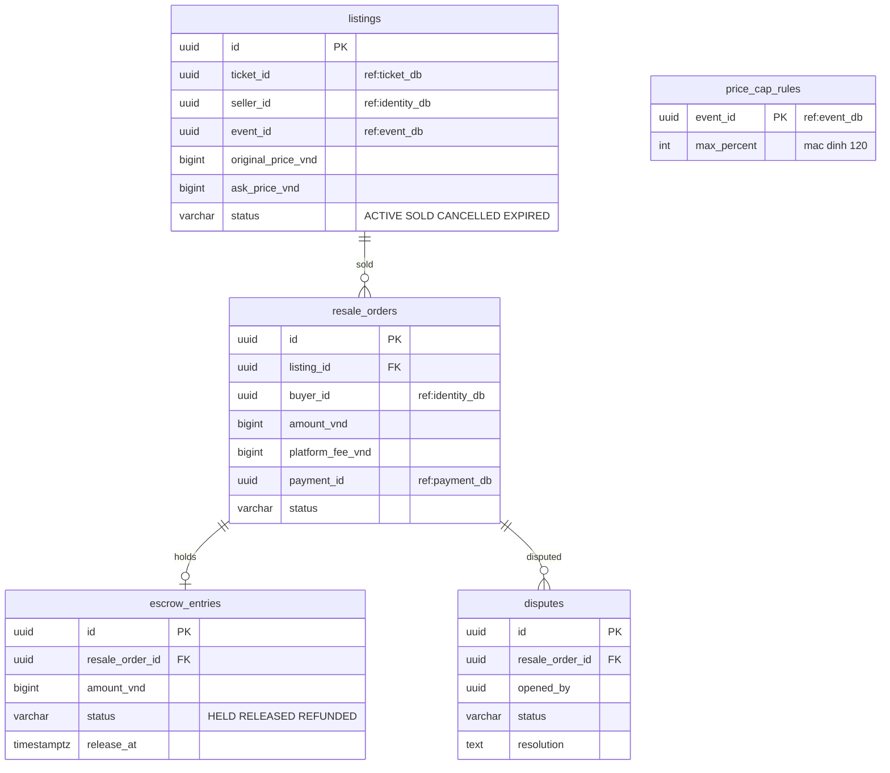
Ràng buộc: `UNIQUE (ticket_id) WHERE status='ACTIVE'` (một vé một listing active); `CHECK (ask_price_vnd <= original_price_vnd * max_percent / 100)` kiểm tra thêm ở tầng ứng dụng.

### 5.7 merch_db

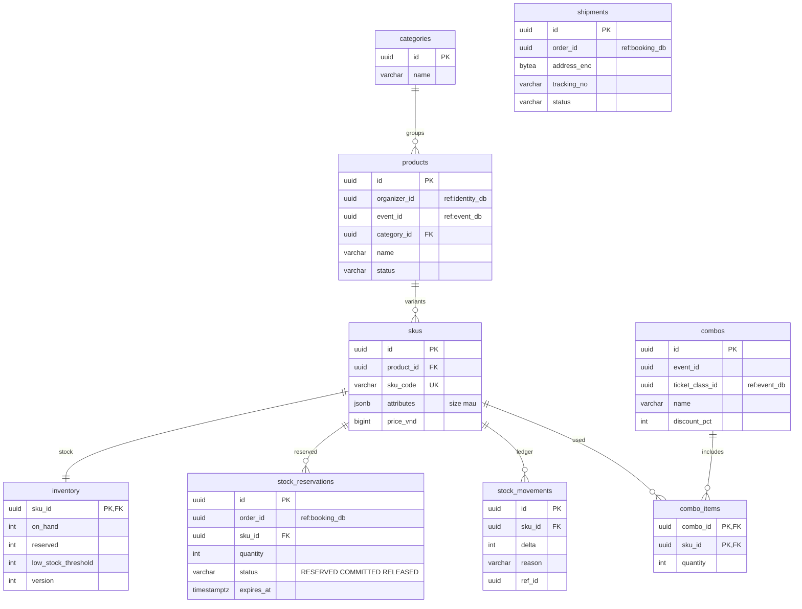
`UNIQUE (order_id, sku_id)` trên `stock_reservations` để reserve idempotent.

### 5.8 notification_db

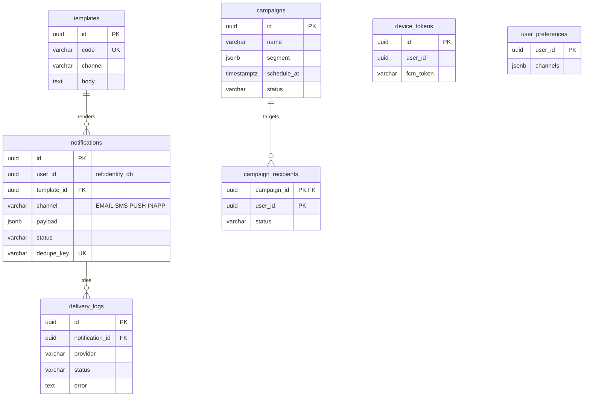
`dedupe_key` (ví dụ `TicketIssued:<ticketId>`) bảo đảm event trùng không gửi hai email.

### 5.9 finance_db

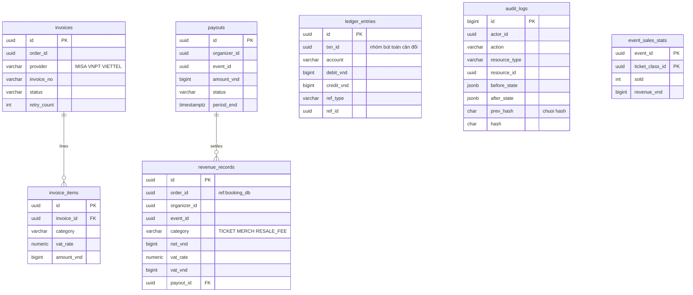
`ledger_entries`, `audit_logs`: chỉ INSERT (thu hồi quyền UPDATE/DELETE, thêm trigger chặn). `audit_logs.hash = SHA256(prev_hash || nội dung)` tạo chuỗi băm phát hiện sửa dữ liệu → đáp ứng "lưu trữ bất biến". `event_sales_stats` là read-model phục vụ dashboard real-time.

### 5.10 ai_db (PostgreSQL + pgvector)

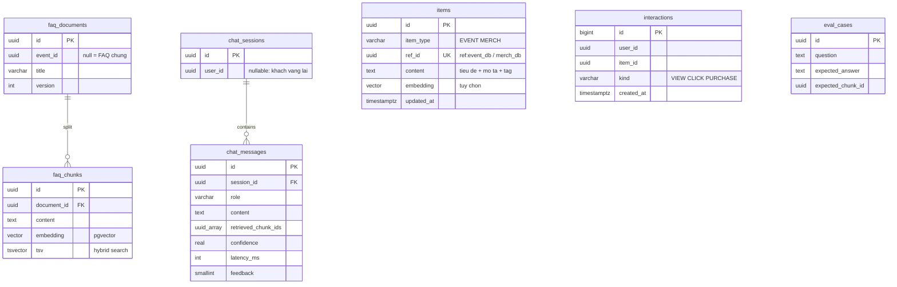
Bảng `eval_cases` là tập kiểm thử RAG, phục vụ đo chất lượng khi báo cáo (mục 9).

---

## 6. Hai điểm thiết kế cần sửa so với tài liệu cũ

### 6.1 Offline check-in với TOTP (đã chốt phương án A)

**Vấn đề:** để tự sinh/so khớp mã TOTP 30 giây, thiết bị soát vé cần **secret (hoặc khóa dẫn xuất)** của vé. Một danh sách *hash* secret không thể dùng để verify. Cần chọn phương án và nêu rõ đánh đổi bảo mật.

| Phương án | Ưu | Nhược |
|---|---|---|
| A. Staff app tải secret từng vé (mã hóa) | Verify offline đầy đủ, không cần mạng | Thiết bị mất cắp là rủi ro → phải giảm thiểu |
| B. Một khóa master theo sự kiện, secret vé = HKDF(master, ticket_id ∥ version) | Gói tải nhẹ | Lộ master = giả mạo mọi vé → rủi ro cao hơn |
| C. QR chứa token do server ký, user online mới lấy được | An toàn nhất | Không đáp ứng yêu cầu mất mạng tại cổng |

**Đã chốt: phương án A** kèm biện pháp giảm thiểu:
- Gói xác thực (`verification package`) chỉ chứa vé của **đúng sự kiện + cổng** được phân công, có TTL, tải qua TLS sau khi Staff đăng nhập.
- Lưu trong IndexedDB, mã hóa AES-GCM với khóa **non-extractable** (WebCrypto) dẫn xuất từ phiên đăng nhập + PIN; xóa khi hết sự kiện/đăng xuất.
- Cho phép lệch ±1 bước TOTP (±30 giây) để bù lệch đồng hồ.
- Offline log là append-only, ký bằng HMAC phía thiết bị; server từ chối batch sai chữ ký.
- Ghi rõ **rủi ro còn lại**: hai cổng offline có thể cho cùng một vé vào trước khi sync. Giảm thiểu: chia vé theo cổng/khu vực, sync định kỳ khi có mạng, server phát hiện trùng (`DUPLICATE`) khi sync và báo Admin.
- Wallet của người dùng (PWA) cũng giữ secret trong IndexedDB; chế độ online ưu tiên lấy token ngắn hạn từ server, TOTP cục bộ là dự phòng.
- **Check-in không phụ thuộc blockchain.** Chain chỉ là lớp neo/tra cứu công khai.

### 6.2 Resale: thứ tự và tính nhất quán

1. Niêm yết: `resale-service` gọi sync `ticket-service` để **FREEZE** vé (idempotent). Fail → không tạo listing.
2. Mua: buyer thanh toán → tiền vào **escrow** (`escrow_entries.HELD`).
3. `ResaleCompleted` → `ticket-service`: chuyển `owner_user_id`, **tăng `secret_version`**, thu hồi secret cũ, phát `TicketTransferred`.
4. Giải ngân escrow theo chính sách (ví dụ sau khi buyer check-in hoặc sau X giờ từ khi chuyển quyền); khiếu nại → Admin xử lý trước khi giải ngân.
5. Staff App nhận **delta thu hồi** (`revoked_ticket_ids`) mỗi lần sync; ghi nhận rủi ro cửa sổ offline như mục 6.1.

---

## 7. Công nghệ cần bổ sung / thay đổi

| Công nghệ | Dùng để | Quan hệ với v1 |
|---|---|---|
| **Cloudflare** (gói free) | CDN, WAF, DDoS, TLS | Mới |
| **Kong DB-less** | Gateway duy nhất (đã chốt) | Thay Kong + Nginx |
| **Redis 7 + Lua + Sentinel** | Hold ghế, queue, cache, pub/sub | Bổ sung Lua, Sentinel |
| **PgBouncer** | Pool kết nối PostgreSQL | Mới |
| **Kafka (KRaft, không Zookeeper)** | Event backbone | Giữ; dev có thể dùng Redpanda cho nhẹ RAM |
| **Outbox/Inbox** (tự viết thư viện dùng chung) | Nhất quán DB ↔ Kafka, idempotent | Mới |
| **pgvector** | Vector search cho AI (giai đoạn sau) | Thay MongoDB |
| **multilingual embedding** (vd. `multilingual-e5-small` hoặc `bge-m3`) + **LLM API** | Chatbot RAG tiếng Việt (giai đoạn sau) | Mới |
| **OpenTelemetry + Jaeger** | Distributed tracing xuyên service | Mới |
| **Prometheus + Grafana + Loki/Promtail** | Metrics, log tập trung | Loki thay ELK |
| **k6** | Load test, gắn vào CI nhẹ | Mới |
| **opossum** | Circuit breaker | Mới |
| **Socket.IO + Redis adapter** | Realtime nhiều replica | Bổ sung adapter |
| **Argon2id, JWT RS256 + JWKS** | Băm mật khẩu, xác thực không cần gọi identity | Nâng cấp |
| **Trivy, OWASP ZAP baseline, `npm audit`/Dependabot** | Quét image/phụ thuộc/ứng dụng | Mới (điểm bảo mật) |
| **Testcontainers, Jest, Playwright** | Test tích hợp + E2E | Mới |
| **Hardhat + OpenZeppelin ERC-721, Pinata** | NFT trên Polygon **Amoy testnet** | Cụ thể hóa |
| **pnpm workspaces + Turborepo** | Monorepo, chia sẻ lib (outbox, auth guard) | Mới |
| **Bỏ:** PM2, MongoDB, ELK, Nginx trùng Kong, gRPC bắt buộc | Giảm độ phức tạp/RAM | Loại |

---

## 8. Bảo mật & tuân thủ (điểm cho nhóm Hệ thống thông tin)

| Hạng mục | Cách làm |
|---|---|
| Xác thực | JWT RS256 (access 10–15 phút) + refresh token **rotation + phát hiện tái sử dụng** (`family_id`); Google OAuth với PKCE |
| Phân quyền | RBAC 4 vai trò + kiểm tra **tenant** (`organizer_id`) ở service, không chỉ ở gateway |
| PII | AES-256-GCM tầng ứng dụng (CCCD, địa chỉ), HMAC cho tra cứu; khóa lưu ngoài DB (Docker secret/Vault dev), có `key_id` để xoay khóa |
| Thanh toán | Chuyển hướng cổng thanh toán, verify chữ ký webhook, `provider_txn_id` unique; không lưu dữ liệu thẻ |
| Chống lạm dụng | Rate limit nhiều tầng, reCAPTCHA khi đăng ký/vào queue, giới hạn vé theo CCCD hash |
| Bất biến & truy vết | `audit_logs` hash-chain, `ledger_entries`/`checkin_logs` append-only, quyền DB tối thiểu |
| Truyền tải | TLS 1.2+, HSTS, security headers (helmet), CORS chặt |
| Chuỗi cung ứng | Trivy quét image, Dependabot, không commit secret (pre-commit hook gitleaks) |
| Sao lưu | `pg_dump` định kỳ lên MinIO/S3 + kiểm tra khôi phục ít nhất một lần |
| Tuân thủ | Tách doanh thu vé / merch cho VAT; hóa đơn qua adapter (MISA/VNPT/Viettel); cổng tra cứu vé công khai |

---

## 9. AI (giai đoạn sau — ngoài phạm vi 6 tuần)

> Phần này giữ lại làm thiết kế tham chiếu, **không nằm trong kế hoạch 6 tuần**. Cách gắn vào sau này xem mục 11.5.

Theo `datn.md`, nên **chọn một hướng và làm sâu**: hướng được chọn là **RAG + thuật toán gợi ý**, không fine-tune.

**Recommender (UC-06)**
- Baseline: TF-IDF + cosine similarity trên nội dung sự kiện/merch (đúng mô tả v1).
- Nâng cấp: **item-item co-purchase** từ `interactions`, trộn điểm: `score = α·content + β·cooccurrence + γ·popularity`. Cold-start dùng content-based.
- Đánh giá: Precision@K / Recall@K / Hit-rate trên dữ liệu giả lập hợp lý (nêu rõ cách sinh dữ liệu) và so sánh baseline vs hybrid.

**Chatbot RAG (UC-16)**
- Pipeline: chia chunk FAQ/quy định sự kiện → embedding đa ngôn ngữ → **hybrid search** (vector + `tsvector`) → LLM sinh câu trả lời **chỉ dựa trên ngữ cảnh truy xuất**, kèm trích nguồn.
- Ngưỡng `confidence`: thấp → trả lời "không chắc" và chuyển hướng liên hệ hỗ trợ (đúng luồng ngoại lệ UC-16).
- Chặn prompt injection cơ bản (cắt vai trò system, không cho tool), giới hạn tốc độ, ghi `chat_messages` để cải thiện.
- Đánh giá: ≥ 50 câu hỏi trong `eval_cases`; đo hit-rate truy xuất, độ đúng của câu trả lời (chấm tay + tiêu chí), độ trễ p95. Đưa bảng kết quả vào báo cáo.
- Tắt/giảm tải AI khi flash sale (load shedding, mục 3.9).

---

## 10. Triển khai & tài nguyên

**Môi trường**
- `dev` (laptop): Docker Compose với **profile**: `core` (kong, identity, event, booking, payment, ticket, merch + Redis, Kafka, 1 PostgreSQL gộp nhiều database, MinIO) và `full` (thêm resale, notification, finance, monitoring).
- `demo/prod`: VPS thật, domain + HTTPS (Cloudflare), CI/CD tự deploy, monitoring có dashboard.

**Tài nguyên (đã chốt: máy 8–16 GB RAM).** Ước lượng thô để lập kế hoạch, cần đo lại ở tuần 1: Kafka ~1 GB (giới hạn heap), Redis < 0.5 GB, mỗi PostgreSQL ~0.2–0.4 GB, mỗi service Node ~0.15–0.3 GB, stack giám sát (Prometheus, Grafana, Loki, Jaeger) ~1–1.5 GB. Tổng profile `full` vào khoảng 6–9 GB.
- **8 GB:** dev dùng profile `core`; bật giám sát chỉ trong các buổi đo.
- **16 GB:** chạy được `full`. Khi load test nên chạy **k6 từ máy khác** (laptop) nhắm vào máy chủ; nếu chạy chung máy, số liệu bị méo vì tranh CPU và phải ghi rõ trong báo cáo.

### 10.1 Sandbox thanh toán: VNPay

Lý do chọn: theo tài liệu sandbox của VNPay, giao dịch test thực hiện được ngay trên trình duyệt bằng thẻ NCB test có sẵn trong tài liệu (OTP test cũng được nêu ở đó), không cần cài app. Tài liệu MoMo thì yêu cầu cài app MoMo Test và dùng tài khoản MoMo test.

Những điểm cần lưu ý khi tích hợp:
1. **Đăng ký sandbox** để nhận `vnp_TmnCode` và `vnp_HashSecret`. Làm việc này ngay tuần 1, vì thời gian cấp có thể phụ thuộc phía VNPay.
2. Chữ ký **HMAC-SHA512** trên các tham số sắp xếp theo thứ tự chữ cái; `vnp_Amount` phải **nhân 100**.
3. Có hai kênh: **Return URL** (trình duyệt, có thể bị can thiệp, chỉ để hiển thị) và **IPN** (server-to-server, là nơi duy nhất được phép chốt trạng thái thanh toán). Webhook handler phải idempotent theo `vnp_TxnRef`/mã giao dịch (đã có `provider_txn_id UNIQUE`).
4. **IPN cần URL công khai.** Dev trên laptop dùng Cloudflare Tunnel (`cloudflared`) hoặc ngrok; khi đã deploy VPS thì dùng domain thật. Cấu hình IPN URL trong trang quản trị sandbox.
5. Cài `IPaymentAdapter` với 2 bản: `VnpayAdapter` và `MockAdapter` (tự gọi webhook nội bộ sau độ trễ ngẫu nhiên). **Load test dùng MockAdapter**, E2E dùng VNPay sandbox. Thêm MoMo sau này chỉ cần viết thêm một adapter.

**CI/CD (GitHub Actions):** lint → unit test → Testcontainers integration → build image → Trivy scan → push registry → deploy staging (tự động) → deploy prod (duyệt tay) → smoke test.

**Cấu trúc repo gợi ý**
```
/apps/web  /apps/staff-pwa
/services/{identity,event,booking,payment,ticket,resale,merchandise,notification,finance}  (NestJS)
/services/ai  (FastAPI)
/packages/{outbox-inbox, auth-guard, event-contracts, logger, otel}
/infra/{compose, kong, grafana, k6}
/docs/{adr, sequence, erd, test-reports}
```

---

## 11. Kế hoạch 6 tuần cho nhóm 3 người

### 11.1 Phân vai

| Thành viên | Vai trò | Phụ trách chính |
|---|---|---|
| **M1** | Tech lead – Platform & Concurrency | Hạ tầng, template service, Kong, `booking`, `payment`, saga/outbox, waiting room, `finance`, load test, observability, CI/CD & deploy |
| **M2** | Backend domain | `identity`, `event`, `ticket` (TOTP, check-in, offline sync, NFT worker), `resale`, cổng tra cứu vé |
| **M3** | Frontend + Merch + Notification | React (User/Organizer/Admin), Staff PWA, `merchandise-service`, `notification-service` |

Quy ước làm việc: stand-up 15 phút/ngày; **demo nội bộ mỗi thứ Sáu**; trunk-based, PR có review chéo; mọi service dùng chung template (health, logging JSON, OTel, auth guard, outbox/inbox) do M1 dựng ở tuần 1; code do AI sinh phải qua test hợp đồng (OpenAPI + event contract) trước khi merge.

### 11.2 Lịch theo tuần

| Tuần | M1 | M2 | M3 | Cột mốc / Tiêu chí hoàn thành |
|---|---|---|---|---|
| **1** Nền tảng & chốt thiết kế | Monorepo, template NestJS, docker-compose hạ tầng (Kafka, Redis, PG, MinIO, Kong), CI, lib outbox/inbox, đo RAM thực tế; **đăng ký VNPay sandbox** | `identity-service`: đăng ký/đăng nhập, Google OAuth, JWT RS256, RBAC, refresh rotation; migration `identity_db`, `event_db` | Monorepo FE (React, Vite, shadcn/Tailwind, React Query), layout + auth UI, client sinh từ OpenAPI; dữ liệu seed sự kiện/merch | `docker compose up` chạy; đăng nhập end-to-end; **chốt OpenAPI + event contract v1 + ADR** |
| **2** Catalog & thử nghiệm concurrency sớm | `booking-service`: Redis Lua hold/release, consumer `event_snapshots`, rehydrate; **k6 baseline S1** | `event-service`: venue, event, ticket class, sale phase, seat map + sinh `seats`, luồng duyệt Organizer/Event, phát `EventApproved` | FE: danh sách/chi tiết sự kiện, wizard tạo sự kiện, seat map Konva (xem); `merchandise-service` CRUD + schema inventory | Demo: Organizer tạo → Admin duyệt → User thấy; **S1 chạy được, oversell = 0** |
| **3** Checkout, thanh toán, vé (MVP lõi) | Order + checkout saga, `payment-service` (VnpayAdapter + MockAdapter, webhook IPN, idempotency), outbox relay, **Waiting Room**, sweeper hết hạn | `ticket-service`: phát hành vé khi `OrderConfirmed`, TOTP secret, endpoint QR/token, ví vé; schema `resale_db` | FE: seat map realtime, giỏ hàng, checkout, trang "Vé của tôi" với QR động; merch reserve/commit + combo upsell | **Happy path E2E:** chọn ghế → thanh toán VNPay sandbox → nhận vé QR động (MVP) |
| **4** Check-in, resale, thông báo | Refund đơn/lô, `finance` tối thiểu (sổ cái, VAT tách vé/merch, audit hash-chain); **load test vòng 1 (S1–S3) + tối ưu** (PgBouncer, index, replica) | Check-in online/offline (gói xác thực, sync, phát hiện trùng), `resale-service` (trần 120%, escrow, chuyển quyền, thu hồi secret) | Staff PWA (Workbox, IndexedDB, WebCrypto), UI resale, `notification-service` (email/in-app qua Mailpit, consumer) | Demo offline check-in; demo resale; email xác nhận vé |
| **5** Quản trị, bảo mật, đóng băng tính năng | Dashboard Grafana (RED, Kafka lag, Redis), **chaos test S4**, hardening (rate limit, headers, ZAP, secrets), **load test vòng 2**, pipeline deploy prod | NFT worker (Amoy testnet, đặt timebox), cổng tra cứu vé công khai, adapter hóa đơn (mock + sandbox nếu có), mã hóa PII hoàn chỉnh, xử lý backlog | Admin portal (duyệt Organizer/Event, refund, xem audit log, xem DLQ), Dashboard Organizer realtime, cảnh báo hết hàng | **Feature freeze cuối tuần 5.** Mọi mục Must + Should xong |
| **6** Deploy product, kiểm thử, hồ sơ, bảo vệ | Deploy production (domain, TLS, auto deploy, backup + thử restore, monitoring), load test & chaos cuối, báo cáo hiệu năng | Playwright E2E cho luồng tới hạn, sửa lỗi, cập nhật SRS/UC/ERD/sequence/ADR cho khớp bản cuối | Trau chuốt UI, seed dữ liệu demo, kịch bản demo, slide, video dự phòng, hướng dẫn sử dụng | Demo trên môi trường deploy thật; **không thêm tính năng mới**; tập dượt ít nhất 2 lần |

### 11.3 Đường cắt giảm khi trễ tiến độ (cắt từ trên xuống)

1. Mint NFT on-chain thật → giữ interface + mock, vé vẫn off-chain hợp lệ (đúng UC-09 A1).
2. Apple/Google Wallet.
3. Hóa đơn điện tử thật → chỉ adapter + mock.
4. Campaign marketing, theo dõi vận chuyển merch.
5. Hoàn tiền một phần (giữ hoàn toàn phần và hoàn lô).
6. Socket.IO → thay bằng SSE hoặc polling 1–2 giây.

**Không được cắt:** Waiting Room hoặc Lua hold + unique index, saga/outbox/inbox, thanh toán sandbox, vé TOTP, check-in, load test + báo cáo, deploy.

### 11.4 Rủi ro chính

| Rủi ro | Khả năng/Tác động | Phòng ngừa |
|---|---|---|
| Quá nhiều service so với nhân lực | Cao / Cao | Template chung; service Should làm sau; `notification`/`finance` chỉ là consumer |
| Sandbox VNPay cấp tài khoản chậm hoặc IPN không tới được máy dev | Trung bình / Cao | Đăng ký ngay tuần 1; dùng `cloudflared` cho IPN; `MockAdapter` để test tải và không chặn tiến độ |
| FE khối lượng lớn (4 portal + PWA) | Cao / Cao | Dùng shadcn + template, ưu tiên luồng User và Staff; Admin/Organizer làm tối giản có chủ đích |
| Load test không đạt do hạ tầng yếu | Trung bình / Cao | Đo sớm ở tuần 2; dùng VPS đủ cấu hình; nêu rõ giới hạn khi báo cáo |
| Tích hợp Kafka/outbox lỗi tinh vi (trùng, mất thứ tự) | Trung bình / Cao | Thư viện dùng chung có test; contract test; kịch bản chaos tuần 5 |
| Nghẽn chờ nhau giữa M1–M2–M3 | Trung bình / Trung bình | Chốt contract ở tuần 1; FE dùng mock server (từ OpenAPI) trong lúc backend chưa xong |
| Thành viên ốm/bận | Thấp / Cao | Review chéo để ít nhất 2 người hiểu mỗi phần lõi |

### 11.5 Giai đoạn sau: tích hợp AI

Thiết kế hiện tại **không cần sửa lõi** để gắn AI vào, nhờ các điểm mở rộng sau:
- Sự kiện đã có sẵn: `event.lifecycle` (nội dung sự kiện cập nhật), `booking.orders` / `payment.events` (tín hiệu mua hàng cho co-purchase). `ai-service` chỉ là **consumer mới** + `ai_db` riêng (mục 5.10).
- Giao diện: Kong thêm route `/ai/*`; FE thêm widget gợi ý và khung chat. Các màn hình đã có chỗ đặt (trang chi tiết sự kiện, giỏ hàng/upsell).
- Cơ chế giảm tải (mục 3.9) đã tính tới việc tắt AI khi flash sale.
- Thứ tự nên làm: recommender TF-IDF + cosine trước (nhanh, có số liệu), RAG chatbot sau, kèm bộ đánh giá `eval_cases` (mục 9). Ước lượng thô khoảng 1–1.5 tuần cho một người, nên chốt lại khi bắt đầu.

Lưu ý khi bảo vệ: `datn.md` có liệt kê tiêu chí về tích hợp AI. Vì AI để sau, hồ sơ nên ghi rõ đây là hạng mục đã thiết kế sẵn (mục 9, 5.10, 11.5) nhưng chưa triển khai, để hội đồng thấy được quyết định có chủ đích.

---

## 12. Checklist hồ sơ theo tiêu chí bảo vệ (`datn.md`)

| Nhóm | Cần có trong hồ sơ |
|---|---|
| **Công nghệ phần mềm** | SRS + UC cập nhật; sơ đồ kiến trúc, sequence (đặt vé, saga, offline sync, resale), ADR cho các quyết định mục 0; ERD từng service; kế hoạch & báo cáo kiểm thử (unit, integration, E2E); báo cáo load test với số liệu |
| **Hệ thống thông tin** | Thiết kế CSDL (chuẩn hóa, index, ràng buộc, partial unique), mô tả database-per-service và cách giữ nhất quán dữ liệu; bảo mật dữ liệu (mã hóa PII, RBAC, audit hash-chain, backup/restore) |
| **Trí tuệ nhân tạo** | Giai đoạn sau: thiết kế đã có (mục 9, ERD `ai_db`, điểm mở rộng mục 11.5). Khi triển khai cần thêm khảo sát hướng tiếp cận, bộ đánh giá và số liệu |
| **Sản phẩm / Deploy** | Domain + HTTPS, CI/CD, dashboard giám sát, backup, tài liệu vận hành, video demo; ứng dụng chạy được trên môi trường thật |

---

### Phụ lục A – Việc cần làm trong tuần 1
Đã chốt: máy 8–16 GB, Kong, VNPay sandbox, offline TOTP phương án A, AI để sau.
- [ ] Đăng ký VNPay sandbox lấy `vnp_TmnCode` / `vnp_HashSecret`; thử `cloudflared` để nhận IPN trên máy dev.
- [ ] Đo RAM thực tế của compose profile `core` và `full`.
- [ ] Chốt chính sách giải ngân escrow (mục 6.2).
- [ ] Đóng băng OpenAPI + event contract v1; tạo ADR-001…ADR-008 tương ứng mục 0.
- [ ] Chọn nơi đặt VPS demo (≥ 8 GB, đề xuất 16 GB) và dựng sớm để M1 deploy thử từ tuần 2–3.
## Đối chiếu domain Sơn — S-603

Bản đặc tả theo revision và tình trạng main/review ngày 2026-11-13 ở [SRS/UC](../specs/son-domain-srs-uc.md), [ERD snapshot](../erd/son-domain-s603.md) và [sequence](../sequence/son-domain-s603.md). Ticket consume OrderConfirmed theo ADR-0009 và S-301. Các phần kiến trúc đích về escrow, NFT on-chain và production cần đọc cùng trạng thái bàn giao của từng task.
