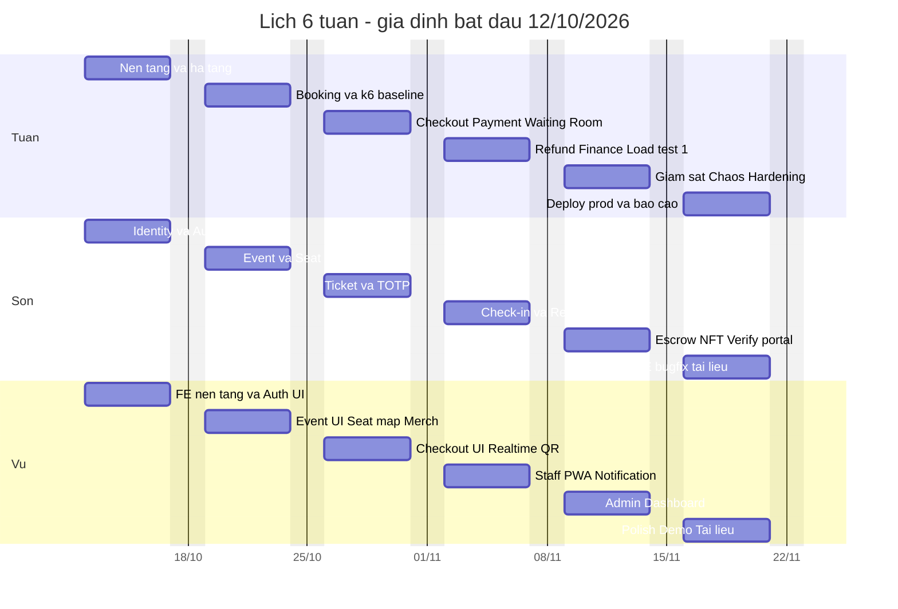

# Kế hoạch triển khai chi tiết — Đồ án Nền tảng phân phối vé sự kiện

**Nhóm:** Tuấn (Tech lead, Platform & Concurrency) · Sơn (Backend domain) · Vũ (Frontend, Merch, Notification)
**Thời gian:** 6 tuần · **Tài liệu gốc:** `DATN_Kien_truc_v2_va_ke_hoach_6_tuan.md` (viết tắt: *Tài liệu KT*)

> **Giả định cần xác nhận**
> 1. Bắt đầu thứ Hai **12/10/2026**, kết thúc thứ Sáu **20/11/2026**. Nếu lệch, dời toàn bộ mốc tương ứng.
> 2. Mỗi người có **~5 ngày công/tuần** (30 ngày/6 tuần). Kế hoạch chỉ xếp **~4–4,75 ngày/tuần** để chừa buffer cho review, họp, sửa lỗi. Nếu ai làm ít hơn, áp dụng đường cắt giảm ở mục 9 sớm hơn.
> 3. Ước lượng đã tính có dùng AI hỗ trợ sinh code. Ước lượng là **ngày công**, chỉ là điểm xuất phát, hãy hiệu chỉnh sau tuần 1.
> 4. Chính sách giải ngân escrow chưa được chốt. **Mặc định tạm:** giải ngân cho người bán khi người mua check-in thành công, hoặc 24 giờ sau khi sự kiện kết thúc (cái nào đến trước). Cần cả nhóm xác nhận trong tuần 1.

---

## 1. Phân công và quyền sở hữu

| Hạng mục | Chủ sở hữu | Người review chính |
|---|---|---|
| Hạ tầng, monorepo, CI/CD, Kong, Kafka, Redis, giám sát, deploy | **Tuấn** | Sơn |
| `booking-service` (Waiting Room, Lua hold, checkout, saga) | **Tuấn** | Sơn |
| `payment-service` (VnpayAdapter, MockAdapter, IPN, refund) | **Tuấn** | Sơn |
| `finance-service` (sổ cái, VAT, audit hash-chain, thống kê) | **Tuấn** (Sơn viết adapter hóa đơn) | Sơn |
| Load test, chaos test, báo cáo hiệu năng | **Tuấn** | Vũ |
| `identity-service` (auth, RBAC, KYC, Organizer) | **Sơn** | Tuấn |
| `event-service` (event, seat map, ticket class, duyệt) | **Sơn** | Tuấn |
| `ticket-service` (vé, TOTP, check-in, offline sync, NFT worker) | **Sơn** | Tuấn |
| `resale-service` (listing, escrow, chuyển quyền) | **Sơn** | Tuấn |
| Web: User / Organizer / Admin portal | **Vũ** | Sơn |
| Staff PWA (offline check-in) | **Vũ** | Sơn |
| `merchandise-service` | **Vũ** | Tuấn |
| `notification-service` | **Vũ** | Tuấn |
| Event contract (`packages/event-contracts`), OpenAPI | Tác giả service, **Tuấn duyệt** | — |

**Quy tắc review chéo bắt buộc:** các đoạn mã lõi về concurrency và nhất quán dữ liệu (Lua script, outbox/inbox, saga, unique index, mã hóa PII, TOTP) cần **2 người cùng đọc** trước khi merge, kể cả khi code do AI sinh.

---

## 2. Quy trình làm việc chung

### 2.1 Nhịp họp

| Họp | Khi nào | Thời lượng | Nội dung |
|---|---|---|---|
| Planning | Thứ Hai sáng | 30 phút | Chốt task của tuần, xác nhận phụ thuộc giữa 3 người |
| Stand-up | Hàng ngày | 10–15 phút | Hôm qua xong gì · Hôm nay làm gì · Bị chặn ở đâu |
| Sync hợp đồng | Thứ Tư | 30 phút | Chốt OpenAPI/event contract cho phần sắp bàn giao |
| Demo + Retro | Thứ Sáu chiều | 60 phút | Demo theo "Cổng nghiệm thu" của tuần, rút kinh nghiệm |

**Quy tắc trễ tiến độ:** nếu task trễ quá **1 ngày**, người phụ trách báo ngay ở stand-up; nếu trễ quá **2 ngày** hoặc chặn người khác, Tuấn quyết định hoặc cắt phạm vi hoặc chuyển người hỗ trợ (xem mục 9).

### 2.2 Git và quản lý công việc

- **Nhánh:** `main` được bảo vệ (bắt buộc PR, CI xanh, ≥ 1 approve). Nhánh làm việc: `feat/<service>-<mô-tả-ngắn>`, `fix/...`, `chore/...`.
- **Commit:** Conventional Commits (`feat(booking): add lua hold script`). Squash merge.
- **PR:** ưu tiên ≤ 400 dòng thay đổi; mô tả có ID task, cách kiểm tra, ảnh chụp nếu là UI. Dùng `CODEOWNERS` theo bảng mục 1.
- **Task:** mỗi task trong bảng bên dưới là **một GitHub Issue** (tiêu đề bắt đầu bằng ID, ví dụ `T-203`). Bảng GitHub Projects: `Backlog → Ready → Doing → Review → Done`. Gắn nhãn `owner:tuan|son|vu`, `week:1..6`, `priority:must|should|could`.
- **Thư mục tài liệu:** `/docs/{adr,sequence,erd,test-reports,user-guide}` trong cùng repo.

### 2.3 Định nghĩa "Sẵn sàng" và "Hoàn thành"

**Sẵn sàng (DoR):** có OpenAPI hoặc event contract liên quan được duyệt; biết rõ ai cần kết quả của task này; có dữ liệu seed/mock để làm.

**Hoàn thành (DoD) chung cho mọi task:**
- [ ] Code merge vào `main`, CI xanh (lint, test, build, Trivy).
- [ ] Có test phù hợp (unit cho logic, integration với Testcontainers cho đường DB/Kafka/Redis).
- [ ] OpenAPI/event contract cập nhật nếu có thay đổi giao diện.
- [ ] Migration chạy được từ DB rỗng và có rollback.
- [ ] Log JSON có `request_id`/`trace_id`; metric cơ bản nếu là endpoint mới.
- [ ] Chạy được bằng `make up`.
- [ ] Người review đã approve; với mã lõi có đủ 2 người đọc.

### 2.4 Làm việc với AI sinh code

1. Đưa cho AI **hợp đồng trước** (OpenAPI, event schema, schema DB), không đưa mô tả mơ hồ.
2. Luôn yêu cầu kèm test; chạy test trước khi review.
3. Không dán secret/khóa thật vào prompt.
4. Người nộp PR chịu trách nhiệm hiểu từng dòng, nhất là Lua, SQL, mã hóa, saga.

---

## 3. Tổng quan lịch



### Các cổng quyết định (Go / No-Go)

| Cổng | Thời điểm | Điều kiện qua cổng | Nếu không đạt |
|---|---|---|---|
| **G1** Concurrency | Cuối tuần 2 | k6 S1: oversell = 0; Lua hold + unique index hoạt động | Dừng làm tính năng mới ở các việc không chặn; Tuấn + Sơn cùng sửa lõi booking |
| **G2** Happy path (MVP) | Cuối tuần 3 | Chọn ghế → thanh toán VNPay sandbox → nhận vé QR động, end-to-end | Cắt combo upsell UI, cắt KYC UI; dồn lực cho luồng chính |
| **G3** Feature freeze | Cuối tuần 5 | Mọi mục Must + Should xong, không còn lỗi chặn luồng chính | Áp dụng đường cắt giảm mục 9; tuần 6 không thêm tính năng |
| **G4** Sẵn sàng bảo vệ | Giữa tuần 6 | Chạy ổn trên môi trường deploy thật, đủ hồ sơ, tập dượt xong lần 1 | Ưu tiên ổn định và demo, bỏ tính năng phụ |

### Tải công việc dự kiến (ngày công, tổng các task bên dưới)

| | T1 | T2 | T3 | T4 | T5 | T6 | Tổng |
|---|---|---|---|---|---|---|---|
| **Tuấn** | 4,5 | 4,5 | 5,0 | 4,5 | 4,75 | 4,0 | 27,25 |
| **Sơn** | 4,5 | 4,75 | 4,5 | 4,75 | 4,5 | 4,5 | 27,5 |
| **Vũ** | 4,5 | 4,5 | 5,25 | 5,0 | 4,5 | 4,5 | 28,25 |

> **Cập nhật sau khi chốt hợp đồng saga (12/10):** T-101 và T-104 đã xong ở Phase 0 nên tuần 1 của Tuấn còn dư; T-201 và T-207 được chuyển về tuần 1. Thêm T-301a, T-203b, S-206, V-306, V-406 và nới T-301/T-206. **Vũ vượt 5 ngày ở tuần 3 (5,25) và tuần 4 (5,0):** nếu T-304 trượt thì V-302 trượt theo; nếu vẫn thiếu thì cắt UI combo (V-406) hoặc để Sơn đảm nhận V-304. Tuần 3 của Tuấn đầy (5,0), T-304 là phần được phép trượt.

---

## 4. Chuẩn bị trước ngày bắt đầu (Ngày 0)

Làm xong **trước thứ Hai tuần 1**; mỗi mục có người phụ trách.

| # | Việc | Người | Ghi chú |
|---|---|---|---|
| 1 | Tạo GitHub org/repo, bảo vệ `main`, bật Actions, Dependabot, tạo Projects board | Tuấn | |
| 2 | Cài công cụ: Node 20, pnpm, Docker, Python 3.11 (nếu cần sau), k6, `cloudflared` | Cả nhóm | Thống nhất phiên bản |
| 3 | Đăng ký **VNPay sandbox** (TmnCode, HashSecret) | Tuấn | Làm sớm vì thời gian cấp phụ thuộc phía VNPay |
| 4 | Tạo Google Cloud OAuth client (redirect URI dev/staging) | Sơn | |
| 5 | Tài khoản Cloudflare, mua/chọn domain demo | Tuấn | |
| 6 | Chọn và thuê VPS demo (≥ 8 GB, đề xuất 16 GB, 4 vCPU) | Tuấn | Dựng sớm để deploy thử từ tuần 2 |
| 7 | Tài khoản Pinata (IPFS) và RPC Polygon Amoy testnet, ví testnet + faucet | Sơn | Chỉ cần cho tuần 5 nhưng nên tạo sớm |
| 8 | Tài khoản thiết kế (Figma) hoặc công cụ wireframe | Vũ | |
| 9 | Họp khởi động 60 phút: đọc lại Tài liệu KT, chốt giả định ở đầu file này | Cả nhóm | |

---

## 5. Kế hoạch chi tiết từng tuần

> Cột **Phụ thuộc** ghi ID task phải xong trước. Ước lượng tính bằng ngày công.

### TUẦN 1 — Nền tảng và chốt thiết kế
**Mục tiêu:** `docker compose up` chạy được; người dùng đăng nhập được end-to-end; chốt hợp đồng API/sự kiện v1.

#### Tuấn
| ID | Công việc | Ngày | Phụ thuộc | DoD |
|---|---|---|---|---|
| T-101 | Monorepo pnpm + Turborepo; ESLint, Prettier, commitlint, husky; cấu trúc `/apps /services /packages /infra /docs` | 0 (xong ở Phase 0) | — | Clone về chạy `pnpm i && pnpm build` thành công |
| T-102 | **Template NestJS service**: config, health/readiness, logger JSON + `request_id`, OpenTelemetry, Swagger, error format chuẩn, auth guard dùng JWKS, Prisma, endpoint `/metrics` | 1,0 | T-101 | Sơn/Vũ tạo service mới từ template trong < 1 giờ |
| T-103 | **`packages/outbox-inbox`**: bảng `outbox_events`/`processed_events`, relay polling `FOR UPDATE SKIP LOCKED`, wrapper consumer idempotent, test Testcontainers | 1,0 | T-102 | Test: publish lỗi giữa chừng không mất/không trùng sự kiện |
| T-104 | **docker-compose hạ tầng**: Kafka KRaft, Redis, PostgreSQL + script tạo **database + user riêng cho từng service**, MinIO, Mailpit, Kong DB-less (declarative); profile `tools` cho Kafka UI/Adminer | 0 (xong ở Phase 0) | T-101 | `make up` lên đủ; `make verify` toàn xanh (gồm kiểm tra cô lập DB) |
| T-105 | CI GitHub Actions: workflow đã có sẵn, chạy lần đầu trên GitHub và đặt 2 check bắt buộc (`build`, `security`) | 0,25 | T-102 | PR chạy CI tự động, fail khi có lỗ hổng mức cao |
| T-106 | Thử `cloudflared` nhận IPN từ VNPay sandbox; đo RAM profile `core` | 0,25 | Ngày 0 #3 | Có ghi chú cấu hình và số đo RAM |
| T-107 | Workshop chốt `packages/event-contracts` (envelope, topic, schema sự kiện) + soạn ADR-001…008 (theo mục 0 Tài liệu KT) | 0,75 | — | Contract v1 merge; ADR được cả nhóm đọc |
| T-301a | Chốt hợp đồng saga: **đã cài đặt sẵn** (`event-contracts`, ADR-0009/0010, OpenAPI nội bộ). Việc còn lại: review, commit, gửi Sơn/Vũ xác nhận | 0,25 | T-107 | PR merge; Sơn và Vũ đã xác nhận phần ảnh hưởng |
| T-201 | Schema + migration `booking_db` (orders, order_items, seat_allocations + **partial unique index `uq_seat_active`**, ticket_class_stock, event_snapshots (+`event_version`, `pricing_ready`), **seat_pricing**, vouchers, idempotency_keys, processed_events, outbox_events) | 0,5 | T-102, T-103 | Index chặn được 2 allocation active cho cùng ghế (có test); migration chạy từ DB rỗng |
| T-207 | Dựng VPS, cài Docker, deploy thử hạ tầng + 1 service lên staging (chưa cần domain đẹp) | 0,5 | Ngày 0 #6 | Truy cập được staging qua HTTPS |

#### Sơn
| ID | Công việc | Ngày | Phụ thuộc | DoD |
|---|---|---|---|---|
| S-101 | Schema + migration `identity_db` (users, oauth_accounts, refresh_tokens, roles, user_roles, kyc_profiles, organizers, organizer_documents) | 0,5 | T-102 | Migration chạy từ DB rỗng, có seed 4 role |
| S-102 | Đăng ký/đăng nhập email, **argon2id**, **JWT RS256 + endpoint JWKS**, refresh token rotation + phát hiện tái sử dụng (`family_id`) | 1,25 | S-101 | Test: dùng lại refresh token cũ → thu hồi cả family |
| S-103 | Google OAuth (PKCE) | 0,5 | S-102 | Đăng nhập Google tạo/liên kết tài khoản |
| S-104 | RBAC guard/decorator + ngữ cảnh tenant (`organizer_id`); seed tài khoản Admin | 0,5 | S-102 | Test truy cập sai role/tenant → 403 |
| S-105 | Đăng ký Organizer + API Admin duyệt/từ chối + upload giấy phép lên MinIO | 0,75 | S-104 | Luồng UC-02 chạy được qua API |
| S-106 | OpenAPI cho identity + bộ request mẫu (Bruno/Postman) | 0,5 | S-102 | Vũ sinh được client từ OpenAPI |
| S-107 | Schema + migration `event_db` (venues, events, ticket_classes, sale_phases, seat_maps, zones, blocks, seats, event_approvals) | 0,5 | T-102 | Migration chạy được; ERD khớp mục 5.2 Tài liệu KT |

#### Vũ
| ID | Công việc | Ngày | Phụ thuộc | DoD |
|---|---|---|---|---|
| V-101 | Khởi tạo `apps/web` và `apps/staff-pwa` (Vite, React 18, Tailwind, shadcn/ui, React Query, Zustand, routing); Axios interceptor tự refresh token | 1,0 | T-101 | Chạy `pnpm dev`; interceptor có test |
| V-102 | Layout, theme sáng/tối, responsive 375–1920 px; trang đăng nhập, đăng ký, nút Google | 1,25 | V-101, S-106 | Đăng nhập được với identity thật (hoặc mock) |
| V-103 | Sinh client từ OpenAPI + **mock server (MSW)** để làm UI khi backend chưa xong | 0,75 | S-106 | Mọi màn hình có thể chạy hoàn toàn bằng mock |
| V-104 | Dữ liệu seed nội dung: 5 sự kiện, merch, ảnh banner (nguồn tự do bản quyền), FAQ cơ bản | 0,5 | — | File seed dùng chung cho cả nhóm |
| V-105 | Wireframe ~12 màn hình: danh sách/chi tiết sự kiện, seat map, hàng đợi, checkout, vé của tôi, Staff quét, wizard Organizer, dashboard, Admin | 1,0 | — | Cả nhóm duyệt wireframe tại sync thứ Tư |

#### Cổng nghiệm thu tuần 1 (demo thứ Sáu)
- [ ] `make up` chạy sạch trên máy cả 3 người.
- [ ] Đăng ký → đăng nhập → refresh token trên giao diện thật; Google login hoạt động.
- [ ] CI xanh trên `main`; template service dùng được.
- [ ] Event contract v1 + OpenAPI identity + ADR đã merge.
- [ ] Đã có số đo RAM thực tế và quyết định chốt escrow (giả định #4).

---

### TUẦN 2 — Catalog và thử nghiệm concurrency sớm
**Mục tiêu:** Organizer tạo sự kiện → Admin duyệt → User thấy; **chứng minh sớm không oversell** (Cổng G1).

#### Tuấn
| ID | Công việc | Ngày | Phụ thuộc | DoD |
|---|---|---|---|---|
| T-202 | **Lua `hold_seats` / `release_seats`**, `SeatHoldService`, REST `POST /holds`, `DELETE /holds`; giới hạn số ghế/người; TTL 10 phút | 1,0 | T-104 | Test song song: 100 client tranh 1 ghế → đúng 1 thành công; hold nhiều ghế là all-or-nothing |
| T-203 | Consumer `EventApproved/Updated` → `event_snapshots`; job **rehydrate** Redis từ `seat_allocations` | 0,75 | T-103, S-203 | Xóa Redis → rehydrate → trạng thái ghế khôi phục đúng |
| T-203b | **Prefetch `seat_pricing`**: khi `EventApproved/Updated` có `seat_map_version` mới, gọi `GET /v1/internal/events/{id}/seat-classes` (phân trang) và upsert; xong mới đặt `pricing_ready=true` (ADR-0010, C5) | 0,5 | T-203, S-206 | Mất kết nối giữa chừng rồi chạy lại vẫn đúng; chưa `pricing_ready` thì không cho bán |
| T-204 | API trạng thái ghế (snapshot nén) + publisher delta gộp lô 500 ms qua Redis pub/sub | 0,5 | T-202 | Client nhận được delta khi ghế đổi trạng thái |
| T-205 | **k6 kịch bản S1** + script SQL kiểm tra oversell + báo cáo baseline v0 (cấu hình máy, RPS, p95, lỗi) | 1,0 | T-202 | `docs/test-reports/s1-baseline.md`; truy vấn kiểm tra trả 0 dòng |
| T-206 | Hoàn thiện Kong: route identity/event/booking, CORS, request-id, rate limit theo IP và **chặn mọi đường `/internal`** (ADR-0010). JWT verify do `auth-guard` trong service (ADR-0004) | 0,75 | T-104 | Request tới service không token → 401 (từ guard); vượt ngưỡng → 429 (từ Kong); `/api/*/v1/internal*` → 404 từ Kong |

#### Sơn
| ID | Công việc | Ngày | Phụ thuộc | DoD |
|---|---|---|---|---|
| S-201 | CRUD venue, event, ticket_classes, sale_phases, kiểm tra tenant | 1,0 | S-107, S-104 | Organizer A không sửa được event của B |
| S-202 | Seat map: validate layout JSON, **sinh zones/blocks/seats hàng loạt** (≥ 10.000 ghế), version bất biến sau khi publish | 1,25 | S-201 | Sinh 10k ghế < vài giây; sửa seat map đã publish bị từ chối |
| S-203 | Luồng duyệt: `DRAFT → PENDING → APPROVED/REJECTED → PUBLISHED`; outbox `EventApproved/Updated/Cancelled` | 1,0 | S-201, T-103 | Máy trạng thái có test; sự kiện xuất hiện trên Kafka |
| S-204 | API công khai (danh sách/tìm kiếm/chi tiết) với **Redis cache-aside + chống stampede + ETag** | 0,75 | S-201 | Test tải đọc: phần lớn request trúng cache |
| S-205 | Script seed: 3 sự kiện, 1 sự kiện ≥ 10k ghế, ticket class, sale phase | 0,25 | S-202 | `pnpm seed` chạy lặp lại được |
| S-206 | API nội bộ `GET /v1/internal/events/{id}/seat-classes` (xem `docs/api/internal/seat-classes.yaml`), xác thực `X-Internal-Key`, phân trang cursor | 0,5 | S-202 | Trả đúng ánh xạ ghế→hạng vé; thiếu khóa → 401; bị Kong chặn từ ngoài |

#### Vũ
| ID | Công việc | Ngày | Phụ thuộc | DoD |
|---|---|---|---|---|
| V-201 | Trang danh sách/tìm kiếm/chi tiết sự kiện | 1,0 | V-102, S-204 | Hiển thị đúng với dữ liệu seed |
| V-202 | **Seat map viewer bằng Konva**: zoom/pan, chọn ghế, chú thích hạng vé, hiệu năng với 10k ghế | 1,5 | V-103 | Mượt khi zoom/pan trên máy trung bình; chọn được ghế |
| V-203 | Wizard Organizer: thông tin sự kiện, ticket class, sale phase, upload banner, gửi duyệt | 1,0 | V-102, S-201 | Tạo sự kiện đầy đủ qua giao diện |
| V-204 | `merchandise-service`: schema `merch_db`, CRUD product/SKU/inventory, upload ảnh | 1,0 | T-102 | API khớp ERD mục 5.7 Tài liệu KT |

#### Cổng nghiệm thu tuần 2 — **G1**
- [ ] Demo: Organizer tạo sự kiện qua UI → Admin duyệt → User thấy trên trang chủ.
- [ ] **k6 S1 (5.000–10.000 VU, 2.000 ghế): oversell = 0** và có báo cáo baseline.
- [ ] Xóa Redis → rehydrate → không có ghế bị bán trùng.
- [ ] Staging truy cập được qua HTTPS.

---

### TUẦN 3 — Checkout, thanh toán, vé (MVP lõi, Cổng G2)
**Mục tiêu:** luồng end-to-end **chọn ghế → thanh toán VNPay sandbox → nhận vé QR động**.

#### Tuấn
| ID | Công việc | Ngày | Phụ thuộc | DoD |
|---|---|---|---|---|
| T-301 | **Checkout API**: một transaction tạo order + items + `seat_allocations(HELD)`, `Idempotency-Key`, giá lấy từ server (`seat_pricing`, `event_snapshots`, báo giá merch qua REST nội bộ khi có merch), máy trạng thái order theo ADR-0009, outbox `OrderCreated` / `OrderAwaitingPayment` | 1,75 | T-202, T-301a, T-203b | Gọi lặp cùng key → cùng kết quả; 2 user cùng ghế → 1 thắng; merch lỗi chỉ ảnh hưởng order có merch |
| T-302 | `payment-service`: schema, `IPaymentAdapter`, **`MockAdapter`**, **`VnpayAdapter`** (tạo URL, chữ ký HMAC-SHA512, `vnp_Amount ×100`, xử lý Return/IPN) | 1,25 | T-103, Ngày 0 #3 | Thanh toán thành công trên VNPay sandbox bằng thẻ test |
| T-303 | Webhook IPN **idempotent** (`provider_txn_id` unique) + outbox `PaymentSucceeded/Failed`; sweeper hết hạn (`SKIP LOCKED`) → `OrderExpired` + bù trừ nhả ghế | 1,0 | T-301, T-302 | Gửi IPN 2 lần chỉ xử lý 1 lần; order quá hạn tự hủy và nhả ghế |
| T-304 | **Waiting Room**: ZSET queue, admission worker (`admit_rate`), admission token JWT ngắn hạn, SSE trạng thái, kiểm tra token ở `/holds` và `/checkout`. *Làm cuối tuần 3; được phép trượt sang đầu tuần 4 mà không chặn G2* | 1,0 | T-202, T-206 | Không có token → từ chối; admit đúng tốc độ cấu hình |

#### Sơn
| ID | Công việc | Ngày | Phụ thuộc | DoD |
|---|---|---|---|---|
| S-301 | Schema `ticket_db`; consumer **`OrderConfirmed`** → **phát hành vé idempotent** theo `order_item_id`, `ticket_secrets` mã hóa AES-256-GCM (có `key_id`) | 1,25 | T-103, T-301a | Event trùng không sinh vé trùng; số vé = số item vé trong order |
| S-302 | Thư viện **TOTP RFC 6238** (cho phép lệch ±1 bước) + endpoint QR/token + API "vé của tôi" | 1,0 | S-301 | Test với vector chuẩn RFC; mã đổi mỗi 30 giây |
| S-303 | Consumer `OrderCancelled`/`RefundCompleted` → vé `REFUNDED/REVOKED` | 0,5 | S-301 | Vé bị hoàn không còn check-in được |
| S-304 | Schema `resale_db` + khung API niêm yết + kiểm tra trần giá | 0,75 | T-102 | Giá > 120% giá gốc bị từ chối |
| S-305 | KYC: OTP (Redis, TTL), lưu CCCD mã hóa + HMAC unique; API phục vụ giới hạn vé theo `kycHash` | 1,0 | S-101 | Một CCCD không gắn được nhiều tài khoản |

#### Vũ
| ID | Công việc | Ngày | Phụ thuộc | DoD |
|---|---|---|---|---|
| V-301 | **Seat map realtime**: snapshot + delta (Socket.IO/SSE), giữ ghế, đếm ngược, toast khi xung đột | 1,25 | V-202, T-204 | 2 trình duyệt thấy trạng thái ghế của nhau trong ≤ 1–2 giây |
| V-302 | Trang Waiting Room (SSE vị trí hàng đợi) + xử lý admission token | 0,5 | T-304 | Hiển thị vị trí; vào được khi tới lượt |
| V-303 | Giỏ hàng, checkout (SKU lẻ, chưa combo), chuyển hướng/nhận kết quả thanh toán | 1,0 | V-301, T-301 | Hoàn tất mua vé qua UI với MockAdapter |
| V-304 | "Vé của tôi" + **QR động** (TOTP phía client, đếm ngược 30 giây, cache offline) | 0,75 | S-302 | QR tự đổi mỗi 30 giây |
| V-305 | `merchandise-service`: consumer `OrderCreated` → **reserve** (chỉ item MERCH), `OrderConfirmed` → commit, `OrderExpired/Cancelled` → release | 1,0 | V-204, T-103, T-301a | `UNIQUE(order_id, sku_id)`; không âm tồn kho |
| V-306 | API nội bộ `POST /v1/internal/quotes` cho SKU lẻ (xem `docs/api/internal/merch-quotes.yaml`); combo trả `422 COMBO_NOT_SUPPORTED` | 0,75 | V-204 | Báo giá đúng; thiếu khóa → 401; SKU không thuộc sự kiện → 409 |

#### Cổng nghiệm thu tuần 3 — **G2**
- [ ] **Demo MVP:** chọn ghế → (queue) → checkout → thanh toán **VNPay sandbox** → nhận email/vé QR động.
- [ ] Gửi IPN trùng và hết hạn order: không mất ghế, không trùng vé.
- [ ] Kiểm tra: số order CONFIRMED (booking_db) = số order có vé (ticket_db).
- [ ] Combo upsell chạy; nếu chưa kịp, ghi vào backlog tuần 4 và không chặn G2.

---

### TUẦN 4 — Check-in, resale, thông báo, load test vòng 1
**Mục tiêu:** soát vé online/offline, resale hoạt động, có số liệu hiệu năng vòng 1.

#### Tuấn
| ID | Công việc | Ngày | Phụ thuộc | DoD |
|---|---|---|---|---|
| T-401 | Refund đơn lẻ + **hoàn lô** (API Admin; VNPay refund hoặc mock), outbox `RefundCompleted` | 1,0 | T-302 | Hủy sự kiện → hoàn lô thành công; ghế/tồn kho được nhả |
| T-402 | `finance-service` tối thiểu: consumer, **sổ cái** (bút toán cân đối, chỉ INSERT), `revenue_records` tách TICKET/MERCH và VAT, **`audit_logs` hash-chain**, `event_sales_stats` | 1,5 | T-103 | Tổng Nợ = tổng Có; sửa bản ghi cũ làm hỏng chuỗi hash (có test phát hiện) |
| T-403 | **Load test vòng 1 (S1–S3, MockAdapter)** chạy k6 từ máy khác; phân tích nút cổ chai; tối ưu (PgBouncer, index, scale `booking` ×3) | 1,5 | G2 | `docs/test-reports/loadtest-1.md`: bảng trước/sau tối ưu, oversell = 0 |
| T-404 | Prometheus scrape + Grafana dashboard cơ bản (RED: rate/error/duration theo service) | 0,5 | T-102 | Dashboard hiển thị p95, lỗi, RPS |

#### Sơn
| ID | Công việc | Ngày | Phụ thuộc | DoD |
|---|---|---|---|---|
| S-401 | Gate + phân công Staff; **API gói xác thực** (verification package) theo event/gate: danh sách vé + secret mã hóa, có TTL (**phương án A**) | 1,0 | S-301 | Staff chỉ tải được gói của cổng được phân công |
| S-402 | **Check-in online**: unique index `uq_checkin_accepted`, mã phản hồi rõ (hợp lệ/đã dùng/sai sự kiện/không hợp lệ) | 0,75 | S-302, S-401 | Quét 2 lần cùng vé → lần 2 trả "đã dùng" |
| S-403 | **Sync offline**: nhận batch có HMAC, phát hiện trùng (`DUPLICATE`), trả delta vé bị thu hồi; `offline_sync_batches` | 1,0 | S-402 | Batch sai chữ ký bị từ chối; trùng giữa 2 thiết bị được ghi nhận |
| S-404 | Resale: tạo listing (**freeze vé qua gọi đồng bộ idempotent**), hủy listing, tìm kiếm, trần 120% | 0,75 | S-304 | Một vé chỉ một listing active (unique index) |
| S-405 | Resale mua: thanh toán, **escrow**, `ResaleCompleted` → chuyển quyền, `secret_version++`, thu hồi secret cũ | 1,25 | S-404, T-302 | Sau chuyển quyền QR cũ vô hiệu, người mua có QR mới |

#### Vũ
| ID | Công việc | Ngày | Phụ thuộc | DoD |
|---|---|---|---|---|
| V-401 | **Staff PWA**: đăng nhập, chọn sự kiện/cổng, tải gói xác thực, lưu **IndexedDB mã hóa (WebCrypto, khóa non-extractable, PIN)**, quét QR bằng camera, verify TOTP cục bộ, màn hình kết quả rõ ràng | 2,0 | S-401 | Tắt mạng vẫn quét và xác thực được vé trong gói |
| V-402 | Hàng đợi đồng bộ (Background Sync), hiển thị xung đột sau sync | 0,75 | S-403, V-401 | Bật mạng lại tự sync; xung đột hiển thị cho Staff |
| V-403 | UI resale: niêm yết, chợ, mua, hủy | 0,75 | S-404 | Luồng UC-13 chạy qua UI |
| V-404 | `notification-service`: consumer `TicketIssued`/`Order*`, template, gửi qua SMTP/Mailpit, thông báo in-app, **`dedupe_key`** | 1,0 | T-103 | Event trùng không gửi 2 email |
| V-406 | Combo upsell: combo API, báo giá combo trong `quotes`, UI upsell trong checkout | 0,5 | V-306, V-303 | Order có combo: giảm giá chỉ áp lên dòng merch; tổng tiền khớp hợp đồng |

#### Cổng nghiệm thu tuần 4
- [ ] Demo **check-in offline** (tắt mạng, quét, bật mạng, sync) và **resale** (niêm yết → mua → QR cũ vô hiệu).
- [ ] Nhận email xác nhận vé (Mailpit).
- [ ] Báo cáo load test vòng 1 có số liệu trước/sau tối ưu; oversell vẫn = 0.
- [ ] Sổ cái cân đối; audit log hash-chain kiểm tra được.

---

### TUẦN 5 — Quản trị, bảo mật, chịu lỗi (đóng băng tính năng, Cổng G3)
**Mục tiêu:** hoàn thiện Admin/Organizer, chứng minh chịu lỗi, siết bảo mật; **feature freeze cuối tuần**.

#### Tuấn
| ID | Công việc | Ngày | Phụ thuộc | DoD |
|---|---|---|---|---|
| T-501 | Dashboard đầy đủ: Kafka consumer lag, Redis, kết nối DB; Loki + Promtail; Jaeger tracing xuyên service | 0,75 | T-404 | Truy vết được một đơn hàng từ gateway tới ticket qua `trace_id` |
| T-502 | **Chaos test S4**: dừng Redis, dừng Kafka, payment trễ giữa lúc chạy S3; sửa lỗi phát hiện; báo cáo | 1,25 | T-403 | Không mất đơn, không trùng vé, hệ thống tự hồi phục; có báo cáo |
| T-503 | Hardening: security headers/CORS, tinh chỉnh rate limit, **OWASP ZAP baseline**, gitleaks pre-commit, xử lý lỗi Trivy, Docker secrets | 1,0 | — | Báo cáo ZAP không còn lỗi mức cao; không còn secret trong repo |
| T-504 | **Load test vòng 2** + báo cáo cuối | 0,75 | T-502 | `loadtest-2.md` so sánh với vòng 1 |
| T-505 | Pipeline deploy: build image, push registry, deploy staging tự động, prod duyệt tay, smoke test | 1,0 | T-207 | Merge vào `main` tự deploy staging |

#### Sơn
| ID | Công việc | Ngày | Phụ thuộc | DoD |
|---|---|---|---|---|
| S-501 | Job **giải ngân escrow** theo chính sách đã chốt + tranh chấp cơ bản (Admin giữ/hoàn) | 0,75 | S-405 | Giải ngân đúng điều kiện; tranh chấp chặn giải ngân |
| S-502 | **NFT worker (timebox 2 ngày)**: hợp đồng ERC-721 (Hardhat + OpenZeppelin) trên Polygon Amoy, consumer `TicketIssued`, retry, `nft_mints`, metadata lên Pinata. Nếu quá timebox → giữ `MockMinter` | 2,0 | S-301 | Vé mint được trên testnet **hoặc** mock hoạt động; lỗi mint không ảnh hưởng vé off-chain |
| S-503 | **Cổng tra cứu vé công khai** (không cần đăng nhập, có rate limit): trạng thái vé + tx hash | 0,5 | S-301 | Tra cứu được tính hợp lệ của vé |
| S-504 | Rà soát mã hóa PII: kyc, secret vé, địa chỉ; script xoay khóa theo `key_id` | 0,5 | S-305 | Xoay khóa không làm mất khả năng giải mã dữ liệu cũ |
| S-505 | `IInvoiceAdapter` + MockAdapter (+ sandbox MISA nếu có) trong `finance-service` | 0,75 | T-402 | Có hóa đơn cho order đã thanh toán; lỗi nhà cung cấp → retry |

#### Vũ
| ID | Công việc | Ngày | Phụ thuộc | DoD |
|---|---|---|---|---|
| V-501 | **Admin portal**: duyệt Organizer, duyệt sự kiện, hoàn tiền lô, xem audit log, xem/replay DLQ | 1,5 | T-401, T-402 | Các luồng UC-02, UC-05, UC-15 chạy qua UI |
| V-502 | **Dashboard Organizer realtime** (Recharts, SSE): doanh thu, tiến độ bán vé và merch, check-in | 1,25 | T-402 | Số liệu cập nhật theo thời gian thực khi có đơn mới |
| V-503 | UI quản lý merch cho Organizer + cảnh báo sắp hết hàng | 0,75 | V-204, V-305 | Tồn kho dưới ngưỡng hiện cảnh báo |
| V-504 | Rà soát trạng thái loading/empty/error, a11y cơ bản, QA responsive | 0,75 | — | Không còn màn hình trắng khi lỗi API |
| V-505 | UI thông báo in-app | 0,25 | V-404 | Chuông thông báo hiển thị và đánh dấu đã đọc |

#### Cổng nghiệm thu tuần 5 — **G3 (Feature freeze)**
- [ ] Mọi mục **Must + Should** xong; việc chưa xong chuyển vào danh sách cắt giảm (mục 9).
- [ ] Báo cáo chaos S4, ZAP, load test vòng 2 đã có.
- [ ] Staging chạy đủ luồng; tag phiên bản `v1.0-rc1`.
- [ ] **Từ thứ Hai tuần 6 chỉ sửa lỗi, không thêm tính năng.**

---

### TUẦN 6 — Deploy product, kiểm thử, hồ sơ, bảo vệ
**Mục tiêu:** demo trên môi trường thật, hồ sơ đầy đủ, tập dượt xong (Cổng G4).

#### Tuấn
| ID | Công việc | Ngày | Phụ thuộc | DoD |
|---|---|---|---|---|
| T-601 | Deploy production: domain, TLS (Cloudflare), secret prod, **backup cron + thử restore thật 1 lần**, smoke test | 1,0 | T-505, G3 | Truy cập được bằng domain; có biên bản restore thành công |
| T-602 | Load test + chaos lần cuối trên môi trường thật; chốt báo cáo hiệu năng | 1,0 | T-601 | Báo cáo cuối kèm cấu hình máy và giới hạn đã biết |
| T-603 | Viết tài liệu kiến trúc, concurrency (mục 3), ADR, báo cáo kiểm thử hiệu năng | 1,5 | — | Cập nhật khớp bản cuối |
| T-604 | Hỗ trợ sửa lỗi, tập dượt bảo vệ | 0,5 | — | — |

#### Sơn
| ID | Công việc | Ngày | Phụ thuộc | DoD |
|---|---|---|---|---|
| S-601 | **E2E (Playwright/API)** cho luồng tới hạn: mua vé, hết hạn order, IPN trùng, check-in, resale (phối hợp Vũ) | 1,5 | G3 | Chạy được trong CI hoặc một lệnh; đạt 100% |
| S-602 | Sửa lỗi tồn đọng | 1,0 | — | Không còn lỗi chặn luồng chính |
| S-603 | Cập nhật SRS/UC/ERD/sequence cho identity, event, ticket, resale; ADR offline TOTP | 1,5 | — | Tài liệu khớp hệ thống thực tế |
| S-604 | Hỗ trợ tập dượt | 0,5 | — | — |

#### Vũ
| ID | Công việc | Ngày | Phụ thuộc | DoD |
|---|---|---|---|---|
| V-601 | Trau chuốt UI, thương hiệu, **seed dữ liệu demo** (sự kiện, người dùng, đơn mẫu) | 1,0 | G3 | Môi trường demo có dữ liệu đẹp, nhất quán |
| V-602 | Phối hợp viết E2E phía UI | 0,5 | S-601 | — |
| V-603 | **Kịch bản demo**, slide, video demo dự phòng | 1,5 | — | Video chạy đủ luồng chính; kịch bản có thời gian từng bước |
| V-604 | Tài liệu: đặc tả màn hình, hướng dẫn sử dụng | 1,0 | — | Có hướng dẫn cho 4 vai trò |
| V-605 | Sửa lỗi UI tồn đọng | 0,5 | — | — |

#### Cổng nghiệm thu tuần 6 — **G4**
- [ ] Demo trọn vẹn trên **domain thật** theo kịch bản; có video dự phòng.
- [ ] E2E đạt 100%; backup đã thử restore; dashboard giám sát hoạt động.
- [ ] Hồ sơ: SRS/UC, kiến trúc, ADR, ERD, sequence, báo cáo kiểm thử (đơn vị, tích hợp, E2E, hiệu năng, chaos, bảo mật), hướng dẫn sử dụng.
- [ ] Tập dượt **ít nhất 2 lần**, có người đóng vai phản biện.

---

## 6. Lịch bàn giao giữa các thành viên

Phụ thuộc chéo là nguồn trễ lớn nhất. Hợp đồng cần được **chốt ở buổi sync thứ Tư** của tuần trước khi bàn giao.

| Hạn | Bên giao → Bên nhận | Sản phẩm bàn giao |
|---|---|---|
| Cuối T1 | Sơn → Vũ | OpenAPI identity, tài khoản test các role |
| Cuối T1 | Tuấn → cả nhóm | Template service, `outbox-inbox`, compose, event contract v1 |
| Giữa T2 | Sơn → Tuấn | Sự kiện `EventApproved` + dữ liệu seed ≥ 10k ghế |
| Cuối T2 | Sơn → Vũ | API event công khai, ticket class, seat map |
| Giữa T3 | Tuấn → Vũ | API `/holds`, `/checkout`, Waiting Room, SSE trạng thái ghế |
| Giữa T3 | Tuấn → Sơn | Sự kiện `PaymentSucceeded` (schema chốt) |
| Giữa T3 | Sơn → Vũ | Endpoint QR/token, API "vé của tôi" |
| Giữa T3 | Vũ ↔ Tuấn | Hợp đồng reserve/commit/release tồn kho merch |
| Đầu T4 | Sơn → Vũ | Đặc tả **gói xác thực offline** (định dạng, mã hóa, TTL) |
| Giữa T4 | Sơn → Vũ | API resale, API sync offline |
| Đầu T5 | Tuấn → Vũ | API refund lô, API thống kê (`event_sales_stats`), SSE dashboard |

**Khi chưa có backend:** Vũ dùng mock server MSW sinh từ OpenAPI để không bị chặn; khi backend giao thì đổi sang endpoint thật và chạy lại test.

---

## 7. Kế hoạch kiểm thử và chất lượng

| Loại | Công cụ | Ai chịu trách nhiệm | Khi nào |
|---|---|---|---|
| Unit | Jest (Vitest cho FE) | Người viết code | Mỗi PR |
| Integration (DB/Kafka/Redis thật) | Testcontainers | Người viết service | Mỗi PR có thay đổi lõi |
| Contract | Kiểm tra OpenAPI + schema sự kiện trong CI | Tuấn thiết lập | Từ tuần 1 |
| Concurrency/Tải | k6 (S1–S4) + script SQL kiểm tra đúng đắn | Tuấn | Tuần 2, 4, 5, 6 |
| Chịu lỗi | Dừng container Redis/Kafka, trễ payment | Tuấn | Tuần 5, 6 |
| E2E | Playwright | Sơn + Vũ | Tuần 6 (khung từ tuần 4) |
| Bảo mật | Trivy, OWASP ZAP baseline, gitleaks, `npm audit` | Tuấn | CI hàng ngày + ZAP tuần 5 |

**Kiểm tra đúng đắn sau mỗi lần load test** (kết quả phải đúng):
```sql
-- booking_db: không có ghế SOLD trùng
SELECT event_id, seat_id, count(*) FROM seat_allocations
WHERE state='SOLD' GROUP BY 1,2 HAVING count(*) > 1;      -- 0 dòng

-- So khớp giữa các DB (chạy bằng script, mỗi DB một truy vấn)
SELECT count(*) FROM orders WHERE status='CONFIRMED';      -- booking_db
SELECT count(DISTINCT order_id) FROM tickets;              -- ticket_db
```

---

## 8. Mẫu dùng chung

### Mẫu Issue
```
Tiêu đề: T-203 Consumer EventApproved -> event_snapshots
Chủ: @tuan   Người review: @son   Tuần: 2   Ưu tiên: must   Ước lượng: 0,75 ngày
Phụ thuộc: T-103, S-203
Mô tả ngắn:
Tiêu chí hoàn thành (DoD):
- [ ] ...
Cách kiểm tra:
```

### Mẫu mô tả PR
```
Liên quan: T-203
Thay đổi gì và vì sao:
Cách kiểm tra (lệnh / bước thao tác):
Ảnh chụp (nếu là UI):
Rủi ro / việc theo sau:
- [ ] CI xanh  - [ ] Test đã thêm  - [ ] OpenAPI/contract đã cập nhật
- [ ] Mã lõi (Lua, saga, outbox, mã hóa, TOTP): đã có 2 người đọc
```

### Mẫu stand-up (3 dòng)
`Hôm qua:` … · `Hôm nay:` … · `Bị chặn bởi:` …

---

## 9. Đường cắt giảm khi trễ tiến độ

Cắt **từ trên xuống**, Tuấn quyết định tại stand-up hoặc cổng G2/G3.

| Thứ tự | Hạng mục bị cắt | Thay thế |
|---|---|---|
| 1 | Mint NFT on-chain thật (S-502) | Giữ `MockMinter`, vé vẫn hợp lệ off-chain |
| 2 | Apple/Google Wallet | Không làm |
| 3 | Hóa đơn điện tử thật | Chỉ adapter + mock (S-505) |
| 4 | Campaign marketing, theo dõi vận chuyển merch | Không làm |
| 5 | Hoàn tiền một phần | Giữ hoàn toàn phần và hoàn lô |
| 6 | Socket.IO | Dùng SSE hoặc polling 1–2 giây |
| 7 | Jaeger tracing | Giữ metrics + log |
| 8 | Dashboard Organizer realtime | Làm bản cập nhật theo chu kỳ |

**Không được cắt:** Waiting Room hoặc (Lua hold + unique index), saga + outbox/inbox, thanh toán sandbox, vé TOTP + check-in, load test + báo cáo, deploy production.

**Việc ngoài phạm vi 6 tuần:** `ai-service` (recommender, chatbot RAG). Thiết kế tham chiếu nằm ở Tài liệu KT, mục 9 và 11.5.

---

## 10. Rủi ro theo dõi hằng tuần

| Rủi ro | Tuần dễ xảy ra | Người theo dõi | Dấu hiệu cảnh báo | Hành động |
|---|---|---|---|---|
| VNPay sandbox cấp chậm / IPN không tới | 1–3 | Tuấn | Chưa có TmnCode đến giữa tuần 1 | Dùng `MockAdapter` cho toàn bộ phát triển; giữ VNPay cho E2E |
| Lỗi tinh vi outbox/inbox (trùng, mất thứ tự) | 3–5 | Tuấn + Sơn | Số vé ≠ số order thanh toán | Dừng tính năng mới, sửa lõi, thêm test tái hiện |
| FE quá tải (4 portal + PWA) | 3–5 | Vũ → Tuấn | Task FE trễ > 1 ngày liên tiếp | Làm tối giản Admin/Organizer; dùng component có sẵn; Sơn hỗ trợ API |
| Load test không đạt do hạ tầng | 2–5 | Tuấn | p95 tăng mạnh, DB bão hòa kết nối | PgBouncer, index, scale ngang; ghi rõ giới hạn trong báo cáo |
| Nghẽn chờ nhau giữa 3 người | 2–4 | Tuấn | Ai đó "đang chờ API" > 1 ngày | Dùng mock server; chốt contract sớm ở sync thứ Tư |
| Sơn quá tải (4 service + NFT) | 3–5 | Tuấn | S-4xx/S-5xx trễ | Cắt NFT trước; Tuấn nhận bớt phần finance adapter |
| Thành viên ốm/bận | Bất kỳ | Cả nhóm | Vắng > 2 ngày | Review chéo để ít nhất 2 người hiểu mỗi phần lõi; áp dụng cắt giảm |

---

## 11. Phân công viết hồ sơ (để không dồn vào tuần cuối)

| Tài liệu | Người viết | Viết dần từ | Hoàn tất |
|---|---|---|---|
| ADR (quyết định kiến trúc) | Tuấn (Sơn thêm ADR TOTP/escrow) | Tuần 1 | Tuần 6 |
| Kiến trúc, concurrency, sequence (đặt vé, saga) | Tuấn | Tuần 2 | Tuần 6 |
| Báo cáo hiệu năng, chaos, bảo mật | Tuấn | Tuần 2 | Tuần 6 |
| ERD + mô tả DB identity, event, ticket, resale | Sơn | Tuần 2 | Tuần 6 |
| Sequence offline check-in, resale; ADR TOTP | Sơn | Tuần 4 | Tuần 6 |
| Cập nhật SRS/UC theo bản cuối | Sơn (phần của mình), Vũ (phần UI) | Tuần 4 | Tuần 6 |
| ERD + mô tả DB merch, notification | Vũ | Tuần 3 | Tuần 6 |
| Đặc tả màn hình, hướng dẫn sử dụng, kịch bản demo, slide | Vũ | Tuần 4 | Tuần 6 |

**Thói quen:** mỗi thứ Sáu, ai hoàn thành tính năng nào thì **cập nhật tài liệu liên quan trong cùng tuần** (khoảng 30 phút), không để dồn.

---

## 12. Danh sách kiểm tra cuối cùng trước bảo vệ

**Sản phẩm**
- [ ] Chạy trên domain thật, HTTPS, dữ liệu demo đầy đủ
- [ ] 4 vai trò (User, Organizer, Staff, Admin) đều demo được
- [ ] Luồng chính: mua vé → thanh toán → QR động → check-in
- [ ] Offline check-in + sync; resale với escrow; merch + combo
- [ ] Dashboard giám sát mở sẵn khi demo

**Kỹ thuật (điểm nhấn)**
- [ ] Số liệu load test S1–S4, oversell = 0, chaos test hồi phục
- [ ] Giải thích được: Waiting Room → Lua → unique index; saga + outbox/inbox; vì sao database-per-service
- [ ] Giải thích được giới hạn đã biết (offline check-in nhiều cổng, TOTP phương án A, môi trường đo)

**Hồ sơ**
- [ ] SRS/UC, kiến trúc, ADR, ERD từng service, sequence, báo cáo kiểm thử, hướng dẫn sử dụng
- [ ] Ghi rõ phần chưa làm: AI (đã thiết kế sẵn), NFT thật/hóa đơn thật nếu bị cắt

**Dự phòng**
- [ ] Video demo, bản sao dữ liệu demo, kịch bản B nếu mạng/cổng thanh toán lỗi (dùng MockAdapter)
