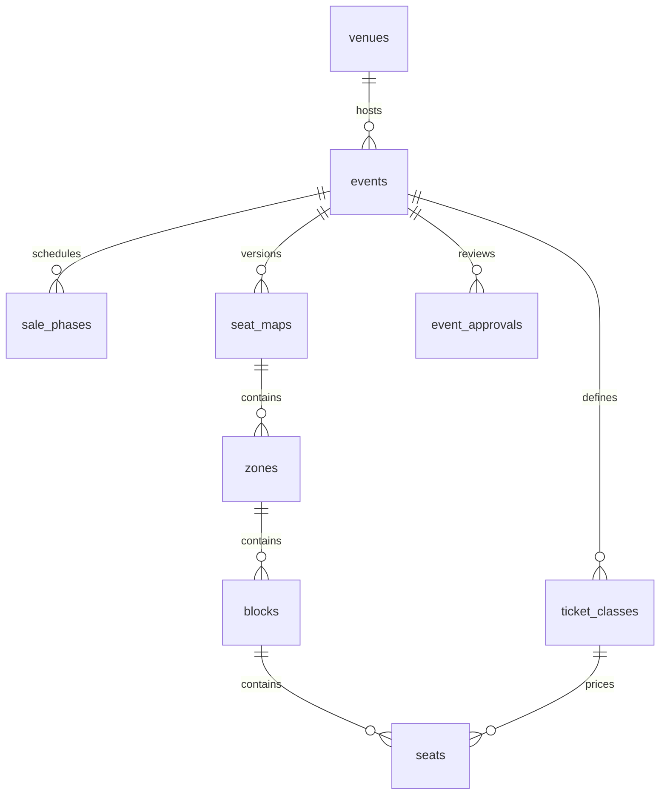

# ERD Event — S-107 và S-201

Nguồn triển khai gồm `services/event/prisma/schema.prisma` và các migration của Event.
Tương ứng architecture-v2 mục 5.2; organizer_id và admin_id chỉ là UUID tham chiếu
logic sang Identity, không FK/JOIN chéo DB.

| Bảng            | Các trường chính / ràng buộc                                                                                     |
| --------------- | ---------------------------------------------------------------------------------------------------------------- |
| venues          | id, organizer_id (ref Identity), name, address, capacity > 0                                                     |
| events          | FK ghép (venue_id, organizer_id) cùng tenant, title, description, banner_key, status, start_at < end_at, version |
| ticket_classes  | event_id, name unique/event, price_vnd bigint 0..9007199254740991, capacity > 0, kind SEATED/GA                  |
| sale_phases     | event_id, starts_at < ends_at, queue_enabled, admit_rate > 0, per_user_limit > 0, require_kyc                    |
| seat_maps       | event_id, version > 0 unique/event, layout JSONB, published_at                                                   |
| zones           | seat_map_id + event_id FK ghép, name unique/map                                                                  |
| blocks          | zone_id + event_id FK ghép, name unique/zone                                                                     |
| seats           | block_id + event_id FK ghép, ticket_class_id + event_id FK ghép, row_label + seat_no unique/block                |
| event_approvals | event_id, admin_id (ref Identity), decision APPROVED/REJECTED, reason                                            |

Mọi bảng nghiệp vụ có UUID và created_at timestamptz; bảng có cập nhật còn có
updated_at và version. Riêng seat_maps.version là phiên bản bất biến của map.
Outbox/Inbox giữ schema chuẩn của packages/outbox-inbox/sql/outbox_inbox.sql.

event_id ở zone/block/seat là dữ liệu lặp có chủ đích để DB chặn quan hệ ghế và hạng
vé khác sự kiện. Không chỉ kiểm tra bằng code ứng dụng.

Status Event bao gồm REJECTED theo S-203 trong plan-6-weeks (sơ đồ tóm tắt kiến trúc
chưa ghi trạng thái này). S-107 chỉ giới hạn tập giá trị, state machine xử lý ở S-203.

Trigger protect_published_seat_map ngăn sửa/xóa map đã publish và chèn/sửa/xóa mọi
zone/block/seat thuộc map đó. Mọi thay đổi layout/publish khóa transaction theo
event để publish đồng thời không mở khoảng hở cho ghi ghế. Chuyển hierarchy sang
event khác bị từ chối; muốn sửa map đã publish phải tạo version mới.

S-201 thêm `idempotency_keys` với unique `(organizer_id, key)`. Kết quả request
ghi được lưu cùng transaction với thay đổi nghiệp vụ. Venue thuộc Organizer.
S-202 phụ trách validate JSON layout và sinh 10k ghế.
