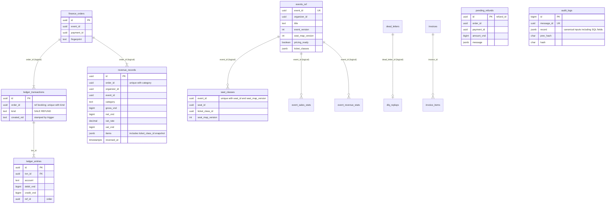
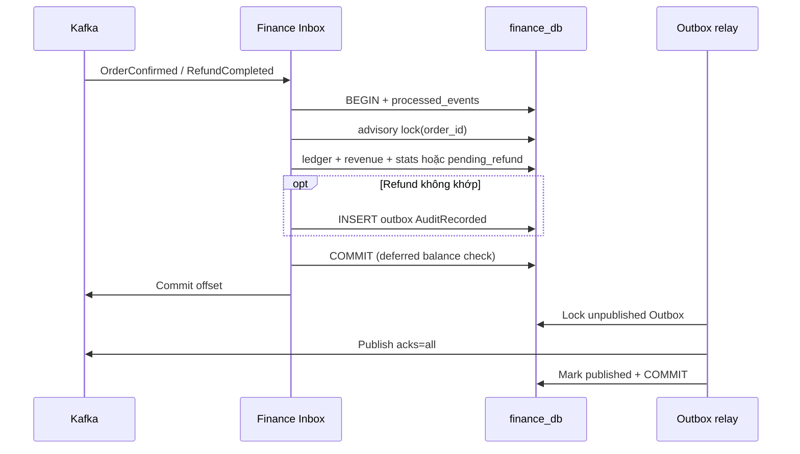

# Finance DB — T-402

Mở rộng ERD 5.9; mô hình chi tiết và kiểu dữ liệu nằm trong `services/finance/prisma/schema.prisma`, CHECK/trigger nằm trong migration. Không có FK/JOIN sang database khác. Không tạo payouts hoặc logic hóa đơn.

`event_sales_stats` duy nhất `(event_id,ticket_class_id)`; `event_revenue_stats` duy nhất `(event_id,category)`. Dead letters duy nhất `(topic,partition,offset)`, replay duy nhất dead_letter_id. Bảng nghiệp vụ có created_at; bảng thay đổi có updated_at/version. Audit dùng bigint id theo ERD gốc. `outbox_events` và `processed_events` theo thư viện dùng chung.

