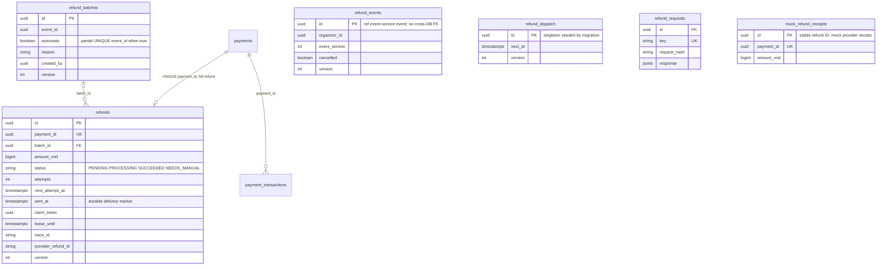

# Payment DB — bổ sung T-401

Mọi bảng có created_at; bảng cập nhật có updated_at/version. Outbox/Inbox hiện có tiếp tục dùng cho RefundCompleted/AuditRecorded và consumer. Claim CHECK bắt buộc PROCESSING có token/lease/sent_at; trạng thái khác không giữ claim. Quota khóa refund_dispatch, không khóa DB qua HTTP. Batch progress tính từ refunds, không dựa vào status cache hoặc counter. Không có FK/JOIN tới DB service khác; mock receipt là ledger mô phỏng provider trong payment_db, không phải dữ liệu provider thật.
