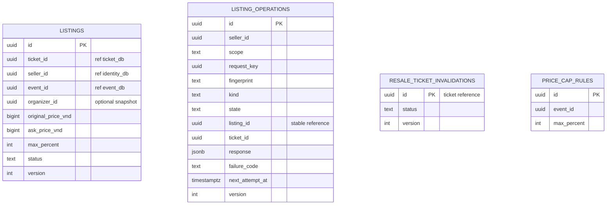

# Resale — S-304 và S-404

Mỗi bảng có created_at/updated_at theo migration. Unique ACTIVE ticket trong listings, unique seller/scope/request_key và unique ticket đang PENDING/FROZEN/RELEASING trong listing_operations. Các ID ngoài DB giữ dạng reference. Snapshot organizer nullable để hỗ trợ listing S-304 đã có.

Ticket DB giữ ticket_freezes với ID bằng listing ID, FK nội bộ ticket_id, snapshot seller/event/organizer/giá, trạng thái FROZEN/RELEASED và version. Partial unique một binding FROZEN mỗi ticket. Chi tiết phục hồi ở ADR-0016.
