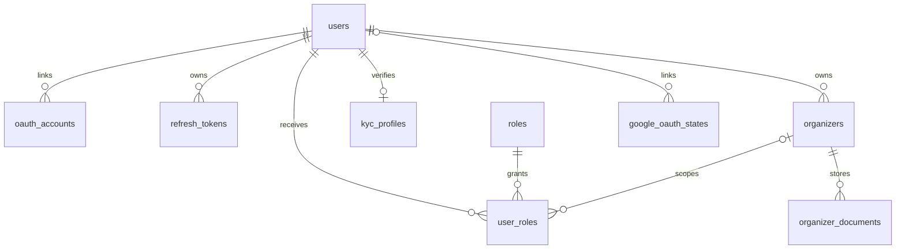
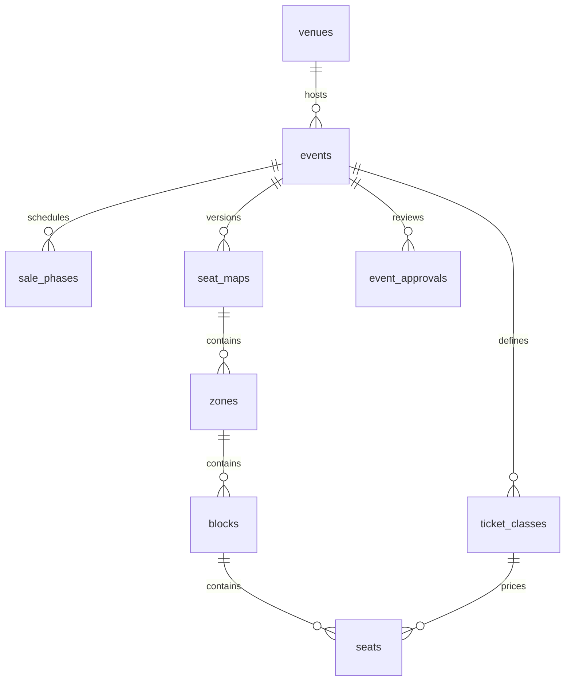
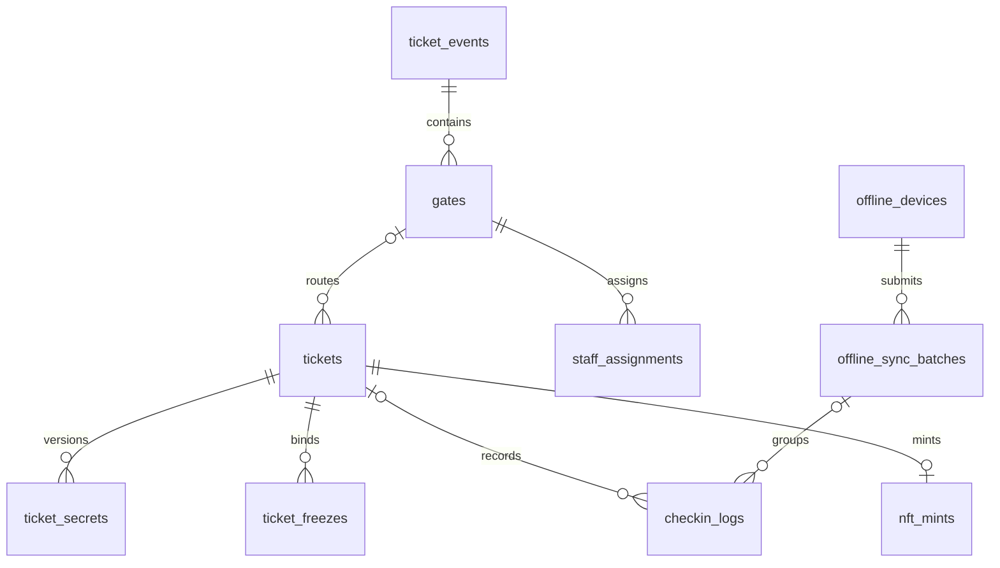
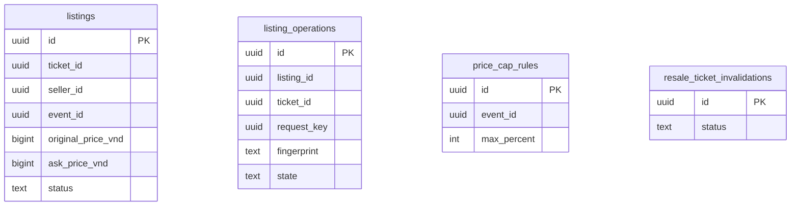

# ERD snapshot domain Sơn — S-603

Ngày 2026-11-13. Baseline và tình trạng merge trong [SRS](../specs/son-domain-srs-uc.md). Source chuẩn là schema Prisma và migration tại main `0977e9d`, #85 `d4276e7`, NFT tại #86 `a274865`. Các đường nối dưới đây nằm trong một DB. UUID tham chiếu service khác là reference logic.

## identity_db

`user_roles` PK `(user_id,role_id)` giới hạn một scope mỗi role. `kyc_profiles` PK user_id, unique id_number_hmac, ciphertext CCCD/tên và key_id. OTP/challenge dùng Redis TTL, profile và receipt dùng PostgreSQL. Refresh lưu token_hash, family_id dùng thu hồi reuse. Object hồ sơ ở MinIO private, DB lưu object_key. `idempotency_keys`, `outbox_events`, `processed_events` phục vụ replay/messaging. Google state có user tùy flow liên kết. KYC handler của #85 dùng schema đã có trên main.

## event_db

organizer_id tham chiếu Identity. FK ghép event/tenant bảo vệ venue, ghế và hạng vé cùng event. Map/version đã publish bất biến bằng trigger. idempotency_keys unique organizer/key, Outbox/Inbox trong DB Event. Chi tiết cột/ràng buộc trong [ERD Event](event.md).

## ticket_db

S-301 trên main có tickets, ticket_secrets, ticket_issuances và ticket_order_invalidations. Unique `(order_item_id,unit_index)` chống phát trùng mỗi đơn vị vé. order_id, owner_user_id, event_id là reference logic. Secret unique ticket/version, key_id xác định khóa giải mã.

#85 bổ sung read-model ticket_events, gate/assignment với composite FK event/organizer, ticket_requests unique actor/scope/key, ticket_freezes và offline devices/batches. Partial unique `uq_checkin_accepted` giữ một ACCEPTED mỗi ticket, `uq_offline_source_scan` chống replay source scan theo device. Log và batch append-only. Log có ticket nullable cho lượt quét ID chưa tồn tại. Package mã hóa nằm trong receipt ticket_requests.

#86 bổ sung nft_mints unique ticket_id, state PENDING/MINTING/MINTED/FAILED, attempts, next_attempt_at, lease_until, version và fingerprint. MOCK lưu mock_reference, tx_hash NULL. #87 đọc tickets LEFT JOIN nft_mints. Hai nhánh Ticket cần tích hợp sau review.

## resale_db

#85 listings partial unique một ACTIVE/ticket. listing_operations unique seller/scope/request_key, partial unique ticket đang PENDING/FROZEN/RELEASING. listing_id là stable reference cho recovery. Tombstone invalidation chặn message đến sớm/đảo thứ tự. Ticket binding nằm trong ticket_db, thao tác qua HTTP service key. Outbox/Inbox nằm trong resale_db.

Order resale/escrow/payout trong architecture là thiết kế đích. Code S-405/S-501 chờ #82, các bảng này cần cập nhật snapshot khi triển khai.
