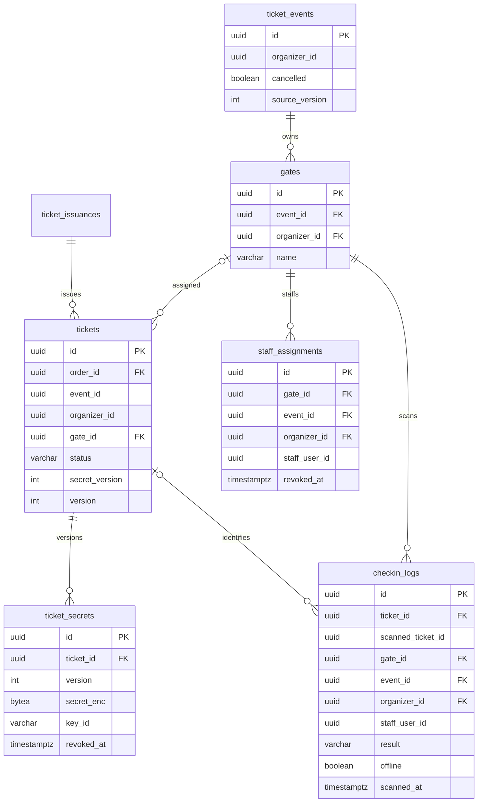

# Ticket DB — S-402

Composite FK của Gate và Staff giữ event/organizer nhất quán. Ticket có gate_id nullable cho vé chờ phân cổng. Log có ticket_id nullable khi ID được quét chưa tồn tại, scanned_ticket_id giữ ID của request. Index `uq_checkin_accepted` chỉ áp dụng log ACCEPTED theo ticket_id. Log chỉ INSERT, có trigger append-only và quyền SQL hạn chế.

`ticket_requests` lưu actor/scope/key/fingerprint/response cho replay idempotent, unique theo actor/scope/key. `ticket_order_invalidations` giữ tombstone hủy/hoàn theo order. `outbox_events` và `processed_events` phục vụ Outbox/Inbox theo thư viện chung. Các ID order, event, organizer, staff tham chiếu service khác qua ID.
