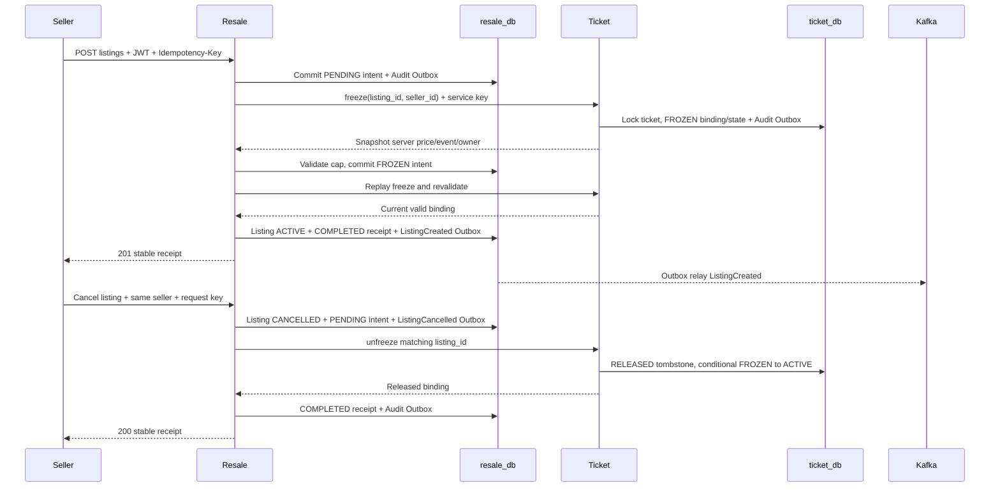

# Niêm yết và hủy vé resale — S-404

Khi phản hồi HTTP mất hoặc DB lỗi, intent đã commit giữ phase hiện hành. Retry cùng key hoặc recovery worker tiếp tục bằng listing ID cũ. Khi cap hoặc trạng thái không hợp lệ, Resale commit RELEASING trước khi bù unfreeze và lưu FAILED sau khi bù thành công. ListingCancelled luôn commit trước release. Các trạng thái terminal ở Ticket được giữ khi release.
