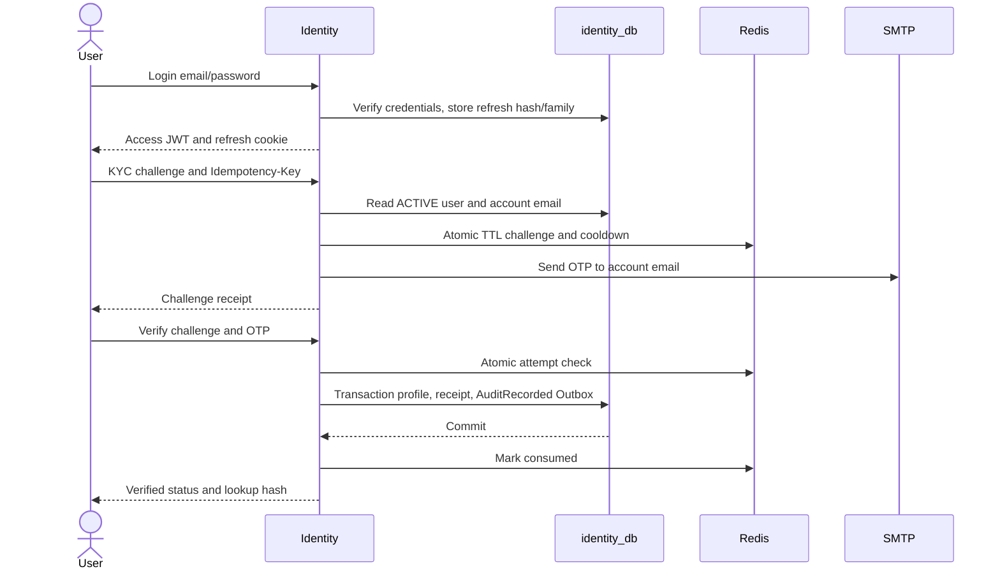
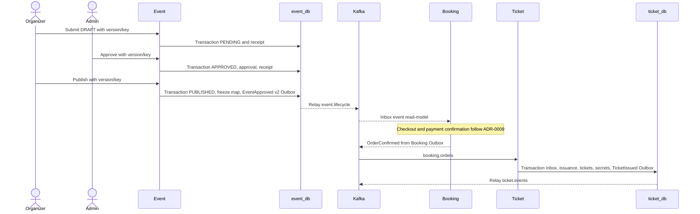
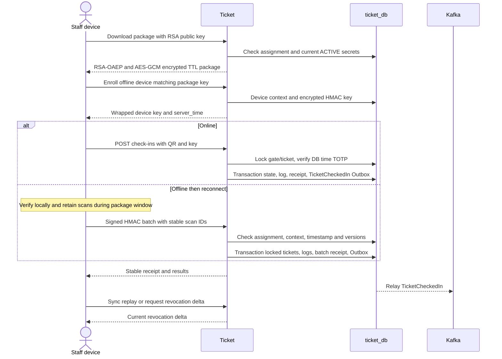
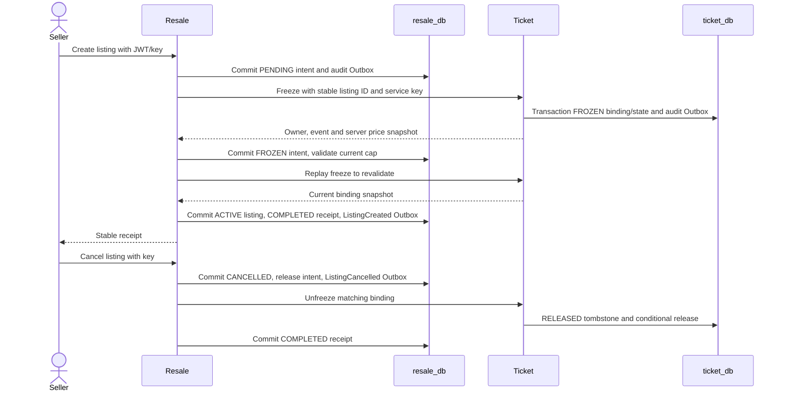

# Sequence domain Sơn — S-603

Baseline và source/test trong [SRS/UC](../specs/son-domain-srs-uc.md). Mỗi transaction dùng DB service sở hữu. Outbox relay chạy sau commit và có thể giao lại, Inbox chặn trùng.

## Identity và KYC

SMTP failure vô hiệu challenge tương ứng, cooldown giữ giới hạn gửi. DB failure rollback profile/receipt/Outbox và cho retry trong TTL. DB receipt giúp replay khi crash sau commit trước Redis consume. Google OAuth state/PKCE và email auth đã merge main, KYC thuộc #85.

## Event publish và phát vé

Ticket bắt đầu từ OrderConfirmed. Booking xử lý payment success theo state machine trước đó. Unique order item/unit cùng fingerprint bảo vệ business replay, invalidation tombstone bảo vệ refund/cancel tới sớm.

## Check-in online và offline

Nhánh check-in nằm trong #85. Unique index bảo đảm một ACCEPTED mỗi vé. HMAC sai bị từ chối trước ghi, quyền Staff được kiểm tra khi replay. Receipt ổn định, delta được lấy mới. Cửa sổ thu hồi và quét trùng giữa thiết bị offline được mô tả trong ADR-0007.

## Listing và phục hồi

Lỗi cap/state khi tạo chuyển RELEASING trước unfreeze, rồi FAILED. Lỗi mạng/DB giữ intent cho retry/recovery worker. Binding RELEASED chặn freeze tới muộn. Flow thuộc #85, S-405/S-501 cùng hoàn tiền resale chờ #82.
