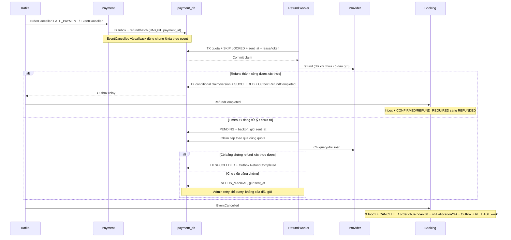

# T-401 — Refund, đối soát và hủy sự kiện

VNPay hiện không có đường đối soát tự động đủ chứng cứ trong adapter: query payment gốc thành công vẫn UNKNOWN rồi NEEDS_MANUAL. Nhánh đối soát thành công được kiểm chứng bằng mock receipt bền vững, không phải bằng chứng E2E VNPay. Worker chết sau dấu gửi phục hồi theo đường đối soát, không lặp refund. Xem ADR-0020 và test `refund.conc-spec.ts` (kill process thật giữa 500 payment).
