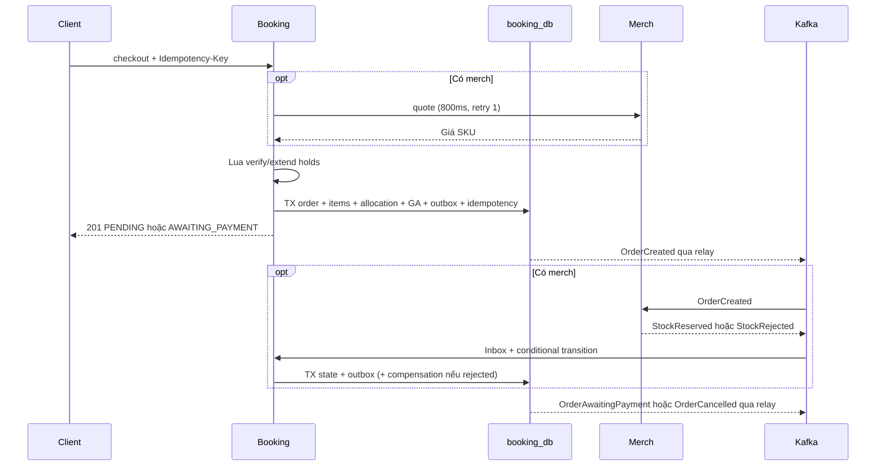
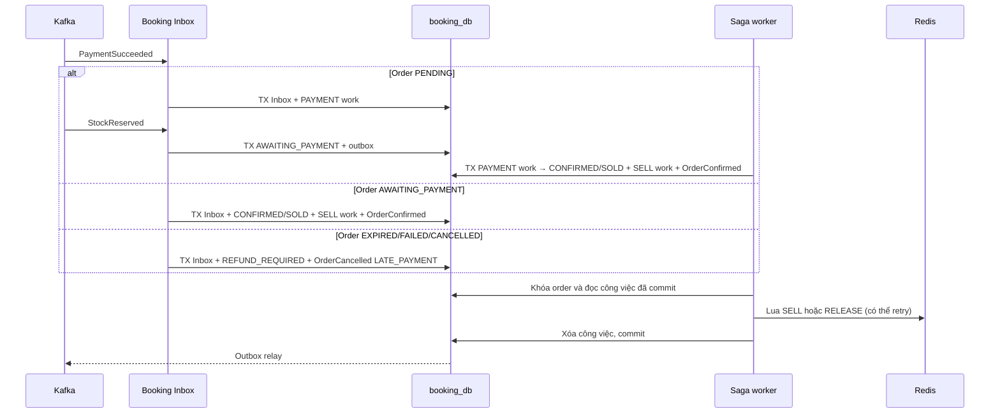

# Booking service — T-201 / T-202 / T-203 / T-204 / T-301 / T-303 / T-304

T-208 bổ sung `GET /v1/orders/{orderId}` (JWT, chỉ chủ đơn). Trả trạng thái backend, tổng tiền VND, hạn thanh toán và items; đơn không tồn tại hoặc khác chủ đều 404. Không cache công khai. Frontend Return chỉ đọc endpoint này, không xác nhận thanh toán từ query VNPay. Hợp đồng additive được Tuấn duyệt tại ADR-0019.

Scaffold có sẵn từ T-102, cổng 3003. T-201 thêm schema `booking_db`; T-202 thêm Lua và API holds; T-203 thêm consumer lifecycle và rehydrate Redis; T-203b thêm prefetch seat pricing; T-204 thêm trạng thái ghế, SSE và sweeper hold. T-301 thêm checkout và stock saga; T-303 thêm saga thanh toán và sweeper order. Health, JWT, log JSON, metrics và endpoint mẫu `/v1/whoami` được giữ từ template.

T-401: EventCancelled v2 hủy order PENDING/AWAITING_PAYMENT bằng cập nhật có điều kiện, nhả allocation/GA trong cùng transaction, ghi Outbox OrderCancelled(EVENT_CANCELLED) và durable RELEASE work cho Redis. Order CONFIRMED chuyển REFUNDED qua RefundCompleted như T-303. Consumer riêng `booking-event-cancel-orders-t401` replay cancellation đã được Inbox lifecycle cũ xử lý trước nâng cấp; snapshot hiện vẫn CANCELLED cùng event_version mới được áp dụng lại phần hủy order. Chạy lặp không nhả stock hai lần. Không đổi schema/OpenAPI booking; không gọi DB payment. Khi Kafka hết retention cần kiểm kê/backfill có kiểm soát. Xem [hướng dẫn nâng cấp](../../docs/ops/t401-upgrade.md).

## Waiting Room (T-304)

Mặc định `ADMISSION_REQUIRED=true`. Với sale phase đang hoạt động có `queue_enabled=true`, client dùng JWT đăng nhập RS256 để gọi `POST /v1/queue/join {event_id}`, rồi mở `GET /v1/queue/status?event_id=<UUID>` bằng SSE có header Authorization. Không gửi token trong URL; trình duyệt dùng fetch streaming để gửi header.

Join trả 201 với `status`, `position` (ZRANK, bắt đầu từ 0), `estimated_wait_sec`; idempotent theo user/event, không phụ thuộc Idempotency-Key. Join lặp không đổi score hay gia hạn admission. Sequence Redis tạo FIFO kể cả nhiều user đến cùng mili giây. Status không tự join. SSE phát `event: status` mỗi giây khi waiting; trạng thái admitted/disabled/not_joined là terminal, server đóng kết nối. Sau khi đã gửi headers, lỗi được phát bằng `event: error {code}` rồi đóng; client reconnect có backoff. Server đóng client chậm khi write buffer đầy, giới hạn số stream mỗi replica và dọn timer khi disconnect/shutdown.

```json
{
  "status": "admitted",
  "position": null,
  "estimated_wait_sec": 0,
  "admission_token": "<JWT>",
  "expires_at": "<UTC ISO-8601>"
}
```

Client gửi `X-Admission-Token` cùng Authorization khi `POST /v1/holds`, `POST /v1/checkout` và `GET /v1/events/:id/seat-stream`. GET/DELETE holds vẫn cho đọc/nhả hold cũ. Phase `queue_enabled=false` bỏ qua guard; cờ ADMISSION_REQUIRED=false là bypass toàn cục có chủ ý. Snapshot thiếu cấu hình phase hợp lệ không được tự coi là queue-disabled. Không đổi Kafka contract, schema DB hoặc API nội bộ của service khác.

Token HS256 chỉ dùng riêng cho admission, claims `sub`, `evt`, `jti`, `iat`, `exp`, issuer `booking-admission`, audience `booking`. Guard chỉ nhận HS256, kiểm tra đúng user/event, thời hạn 5–10 phút và grant còn hiệu lực trong Redis với cùng jti/iat/exp. Thiếu/hết hạn/sai token trả 403 ADMISSION_REQUIRED. Redis lỗi trả 503 QUEUE_UNAVAILABLE; đường POST có Retry-After: 1. Reconnect phát lại token từ cùng grant, không gia hạn TTL. Redis mất dữ liệu thì queue/admission mất theo, token cũ không vượt guard; khách phải join lại. Order/allocation và chốt chống oversell vẫn nằm trong PostgreSQL.

Worker đọc `sale_phases` đã đồng bộ vào `event_snapshots.sale_window` của booking_db; chỉ xử lý sự kiện APPROVED/PUBLISHED trong phase đang bán. `admit_rate` là số user/tick 1 giây theo spec T-304; không catch-up tick bỏ lỡ. Hai replica có thể scan, nhưng Lua chỉ cho một replica cấp mỗi event/tick: Redis TIME xác định tick, SET NX PX giữ khóa tới đầu giây Redis kế tiếp; khóa, prune grant hết hạn, cấp grant và dequeue chạy cùng script. Worker chết sau Lua thì grant vẫn có để SSE replica khác đọc và ký token. Phase deadline được kiểm tra lại trong Lua để replica bị pause không cấp sau hạn.

Trần `ADMISSION_MAX_ACTIVE` áp theo event, số được cấp mỗi tick là min(admit_rate, số slot còn lại). Slot tồn tại tới hạn admission, không nhả sớm khi checkout. Estimated wait = floor(position/admit_rate)+1, chỉ là ước lượng tốc độ; chạm trần active có thể chờ lâu hơn. Mỗi tick cấp tối đa 10000 user theo giới hạn cấu hình cap; Lua không dùng KEYS/SCAN. Queue/sequence có TTL, admitted/grant metadata có TTL và score hết hạn riêng từng user để prune chính xác.

| Key                      | Kiểu   | Nội dung                             |
| ------------------------ | ------ | ------------------------------------ |
| `queue:{evt:E}`          | ZSET   | member user ID, score FIFO sequence  |
| `queue-sequence:{evt:E}` | String | INCR cho FIFO, cùng TTL queue        |
| `admitted:{evt:E}`       | ZSET   | user ID → expiry ms                  |
| `admission-data:{evt:E}` | Hash   | user ID → jti/iat/exp; không lưu JWT |
| `admission-tick:{evt:E}` | String | Khóa NX PX đến đầu tick kế tiếp      |

| Biến                        | Mặc định | Giới hạn / ý nghĩa                                                                                      |
| --------------------------- | -------- | ------------------------------------------------------------------------------------------------------- |
| ADMISSION_REQUIRED          | true     | Bật bảo vệ cho phase queue-enabled                                                                      |
| ADMISSION_TOKEN_SECRET      | Không có | Bắt buộc khi admission bật, ít nhất 32 ký tự ngẫu nhiên; mọi replica dùng cùng secret từ secret manager |
| ADMISSION_TOKEN_TTL_SECONDS | 600      | 300–600 giây                                                                                            |
| ADMISSION_MAX_ACTIVE        | 1000     | 1–10000 user/event                                                                                      |
| QUEUE_TTL_SECONDS           | 86400    | 600–604800 giây, refresh khi join                                                                       |
| QUEUE_MAX_STREAMS           | 1000     | 1–10000 stream/replica                                                                                  |
| QUEUE_WORKER_ENABLED        | true     | Tắt scheduler khi test thủ công hoặc export OpenAPI; độc lập EVENT_CONSUMER_ENABLED                     |

Không có secret mặc định; điền ADMISSION_TOKEN_SECRET vào môi trường riêng trước khi chạy. Metrics: `booking_queue_admitted_total`, `booking_queue_operations_total{outcome}`, `booking_queue_streams`; không có label user/event. Kong dev và loadtest cho phép X-Admission-Token trong CORS. Luồng đã kiểm chứng đến checkout; E2E tới payment/ticket thuộc nghiệm thu G2 chung, không phải bằng chứng của riêng T-304. Xem [run report](../../docs/agent/runs/T-304.md).

## Checkout và stock saga (T-301)

`POST /v1/checkout` yêu cầu JWT và `Idempotency-Key` (1–200 ký tự ASCII hiển thị, không khoảng trắng). Body:

```json
{
  "event_id": "<event UUID>",
  "seat_ids": ["<seat UUID>"],
  "ga_items": [{ "ticket_class_id": "<GA class UUID>", "quantity": 2 }],
  "merch_items": [{ "sku_id": "<SKU UUID>", "quantity": 1 }]
}
```

Có ít nhất một item. Mảng bỏ qua mặc định rỗng; mỗi mảng tối đa 1000 phần tử, không trùng ID, quantity nguyên 1–1000. Không nhận giá/user_id/combo từ client. `voucher_code` có giá trị trả `422 VOUCHER_NOT_SUPPORTED`. AdmissionGuard kiểm tra token khi phase bật queue (xem T-304 ở trên).

Response 201 gồm order_id, status, ticket_amount_vnd, merch_amount_vnd, total_amount_vnd, expires_at. Cùng key/user/hash trả lại response lúc tạo, kể cả sau khi trạng thái đổi; khác user/hash trả `422 IDEMPOTENCY_KEY_REUSED`. Hash chuẩn hóa thứ tự các mảng. Key có phạm vi toàn bảng theo schema T-201. Advisory lock theo key giữ tới commit; response, order và outbox ghi cùng transaction. Checkout khác key của cùng user/event cũng được tuần tự hóa để cleanup không tranh nhau.

Snapshot phải APPROVED/PUBLISHED và trong sale_window; không đạt trả `409 EVENT_NOT_ON_SALE`. Chưa pricing_ready trả `503 EVENT_NOT_READY`, `Retry-After: 1`. Giá vé chỉ đọc booking_db, lọc seat_pricing đúng seat_map_version; không gọi event-service. Shared lock snapshot ngăn lifecycle thay giá/phiên bản giữa transaction.

Lua kiểm tra tất cả seat key và hold membership trước mọi ghi; sai chủ/thiếu hold trả `409 HOLD_NOT_FOUND`. Gia hạn một lần tới payment window. Marker `checkout:{evt:E}:<seatId>` lưu chủ/deadline, có TTL cùng ghế; retry sau rollback giữ deadline đầu tiên, không gia hạn thêm. Release đúng chủ dọn marker. Transaction tạo PENDING, items, allocations HELD, reserve stock GA bằng UPDATE có điều kiện, OrderCreated và response idempotency. Ghế đánh số bảo vệ bằng uq_seat_active; GA dùng counter (kiến trúc mục 3.5). Không merch thì chuyển AWAITING_PAYMENT và ghi OrderAwaitingPayment trong cùng transaction. Unique conflict rollback, nhả hold đúng chủ, trả 409 SEAT_UNAVAILABLE. Redis lỗi trả 503 SEAT_HOLD_UNAVAILABLE. Mọi 503 checkout có Retry-After: 1.

MerchQuotePort chỉ được gọi nếu có merch_items. Client HTTP thật POST trực tiếp MERCH_INTERNAL_URL/v1/internal/quotes với X-Internal-Key, không theo redirect. Timeout mặc định 800 ms bao gồm body, 1 retry; opossum mở mạch sau tối thiểu 5 request với tỷ lệ lỗi ≥50%, thử lại sau 10 giây. Kiểm tra SKU/quantity, số nguyên an toàn, tổng tiền và từ chối combo trong quote. Lỗi/mạch mở trả 503 MERCH_UNAVAILABLE. Order chỉ có vé không gọi client, kể cả khi mạch đang mở.

Consumer booking-checkout-stock đọc merch.stock qua Inbox. StockReserved khớp đủ các dòng merch chuyển PENDING → AWAITING_PAYMENT và outbox; duplicate/stale bỏ qua. Reserved sau hạn không mở thanh toán. StockRejected cho PENDING/AWAITING_PAYMENT chuyển CANCELLED, trả GA, RELEASED allocations, ghi công việc nhả Redis và OrderCancelled với reason STOCK_REJECTED trong cùng transaction. Từ T-303, cleanup Redis chạy sau commit qua hàng công việc bền vững; lỗi giữ công việc để retry. Schema/reservations sai đi DLQ qua thư viện Inbox. Stock/payment consumer và OutboxRelay khởi động/dừng cùng lifecycle. EVENT_CONSUMER_ENABLED=false chỉ dùng test HTTP/OpenAPI, cũng tắt stock/payment/relay và worker saga. Giới hạn relay hiện có: chạy một relay cho booking_db để bảo toàn thứ tự key.



Env: ORDER_PAYMENT_WINDOW_SECONDS=900, ORDER_EXPIRY_GRACE_SECONDS=30, MERCH_INTERNAL_URL=http://localhost:3007, MERCH_QUOTE_TIMEOUT_MS=800. INTERNAL_API_KEY đã có từ T-203b. T-301 không thêm migration; migration của T-303 mô tả bên dưới. Khi S-206 chưa có, dùng pricing:seed bên dưới trên snapshot giả local; integration dùng container và HTTP server giả, không sửa DB service khác.

Kiểm chứng checkout: [run report T-301](../../docs/agent/runs/T-301.md); thanh toán/sweeper: [run report T-303](../../docs/agent/runs/T-303.md). Voucher/combo và Waiting Room chưa thuộc phạm vi đã triển khai.

## Prefetch seat pricing (T-203b)

`EVENT_INTERNAL_URL` trỏ trực tiếp tới event-service trong mạng nội bộ (dev: `http://localhost:3002`), không qua Kong. `INTERNAL_API_KEY` bắt buộc, phải trùng khóa của S-206; không dùng khóa mẫu ở production. Client gửi `X-Internal-Key`, pin `seat_map_version`, phân trang cursor với limit 1000. Timeout 2 giây bao gồm đọc body, tối đa 3 lần thử với backoff 100/200 ms; chỉ retry lỗi mạng, timeout, HTTP 429/5xx. Không theo redirect để tránh chuyển khóa sang host khác.

Worker chạy cùng lifecycle consumer (`EVENT_CONSUMER_ENABLED=true`), quét snapshot APPROVED chưa ready mỗi giây, tối đa 100 snapshot/trang. Snapshot chưa ready là hàng đợi bền vững sau Inbox commit: crash/restart hoặc S-206 chưa sẵn sàng sẽ tự thử lại, không cần replay Kafka. Event lỗi không chặn event khác trong cùng lượt quét. Metric `seat_pricing_jobs_total{outcome="success|failure"}` và log chứa event/version, request_id/trace_id, không chứa khóa hoặc body lỗi.

Worker tải trang ngoài transaction, kiểm tra event/version, cursor lặp và ghế trùng. Sau đó khóa snapshot, kiểm tra lại version/status/readiness, validate hạng vé và upsert từng batch 1000 ghế cùng `pricing_ready=true` trong một transaction. Lỗi giữa chừng không công bố dữ liệu dở; chạy lại tải từ trang đầu. Job cũ bị bỏ qua nếu snapshot đã sang map mới hoặc bị hủy. Lifecycle có map version thấp hơn snapshot bị bỏ qua, kể cả khi event_version cao hơn. Version 0 (không seat map) không gọi seat API.

POST `/holds` dùng kiểm tra readiness cục bộ và trả `503 EVENT_NOT_READY`, `Retry-After: 1`. Checkout kiểm tra readiness trước tạo order, trả cùng header và lọc `seat_pricing.seat_map_version = event_snapshots.seat_map_version` khi tính giá; các ghế thuộc map cũ không còn trong map mới vẫn có thể nằm trong bảng. Kiểm chứng HTTP checkout nằm trong T-301.

Dev khi chưa có S-206: chuẩn bị snapshot bằng `event:fake`, file JSON chứa mảng `[{"seat_id":"<uuid>","ticket_class_id":"<uuid trong snapshot>"}]`. Truyền cấu hình booking hợp lệ từ `.env.example` qua environment, thêm `SEED_EVENT_ID`, `SEED_SEAT_MAP_VERSION`, `SEED_SEATS_FILE` (đường dẫn tính từ `services/booking`), rồi chạy:

```bash
pnpm --filter @ticketing/booking pricing:seed
```

Script không tự đọc `.env`, không tạo/sửa snapshot, không chạy ở production; dùng cùng pipeline atomic/version guard. Snapshot đã ready, thiếu, bị hủy hoặc khác version sẽ được bỏ qua. Để worker gọi client thật khi Sơn chưa xong S-206, test integration dùng server HTTP giả theo `docs/api/internal/seat-classes.yaml`.

## Chạy local

Từ thư mục gốc repo:

```bash
make up && make verify
cp services/booking/.env.example services/booking/.env
pnpm --filter @ticketing/booking exec prisma migrate deploy
pnpm --filter @ticketing/booking dev
```

Prisma CLI đọc `.env` trong thư mục service. Không commit `.env`. `DATABASE_URL` phải trỏ tới `booking_db` bằng `booking_user`; env schema từ chối user/DB khác. Không dùng user `postgres`, không FK hoặc JOIN sang DB service khác.

## Consumer lifecycle và rehydrate (T-203)

Consumer dùng `createInboxConsumer`, group mặc định `booking-event-lifecycle`, Inbox consumer name cố định `booking-event-lifecycle`.
Đọc `event.lifecycle` từ đầu cho group mới; Inbox, snapshot và stock cùng một transaction.
Chỉ nhận **lifecycle v2**, xem [ADR-0011](../../docs/adr/0011-versioned-event-lifecycle.md).
V1 thiếu payload/version nên đi `event.lifecycle.dlq` ngay, không ghi Inbox; không suy đoán hoặc gọi DB event-service.
Sơn cần chuyển producer sang v2 và phát lại snapshot/cancellation v2 hợp lệ trước khi dùng consumer này trên dữ liệu thật.

Snapshot chỉ thay đổi khi event_version tăng; bản cũ/bằng phiên bản không sửa stock.
`total=GREATEST(capacity,sold)` bảo toàn vé đã bán. Cancel đặt CANCELLED và pricing_ready=false;
cancel đến trước approval tạo tombstone để chặn approval cũ. `seat_map_version` lưu từ snapshot v2,
map thay đổi đặt pricing_ready=false; consumer không bao giờ đặt cờ true (T-203b phụ trách).
Updated giữ map cũ thì giữ giá trị pricing_ready hiện tại.

Startup đọc allocation từ booking_db, phân trang 500 dòng theo UUID:

- SOLD → `seat:{evt:<id>}:<seatId>=S`, thêm vào `sold:{evt:<id>}`.
- HELD chỉ khôi phục khi order PENDING/AWAITING_PAYMENT chưa hết hạn, value `H:<userId>`;
  `PXAT` đúng hạn DB, tạo hold set cùng TTL và hexp để các thao tác T-202 đọc được dữ liệu đã khôi phục.
- Lua kiểm tra kiểu metadata trước khi ghi; `SET NX` không ghi đè ghế/TTL/metadata đã có.
  Có thể chạy lại hoặc chạy nhiều replica. Không dùng KEYS/SCAN. Hold chỉ có trong Redis không được phục hồi.

`/health/ready` trả 503 đến khi rehydrate và consumer khởi động xong, sau đó kiểm tra DB như trước.
Nếu startup lỗi, readiness giữ 503; khắc phục DB/Redis/Kafka rồi restart booking để chạy lại.
Shutdown chờ job/consumer dừng trước khi đóng kết nối. Log startup có số allocation dựng lại và trace_id/request_id.

Env mới trong `.env.example` và schema: `KAFKA_BROKERS` (danh sách host:port phân cách dấu phẩy),
`EVENT_CONSUMER_GROUP_ID`, `EVENT_CONSUMER_ENABLED=true`, `REHYDRATE_ENABLED=true`.
Chỉ tắt rehydrate khi đã xác nhận Redis đủ dữ liệu, hoặc trong test chỉ kiểm tra DB/OpenAPI.
Sau Redis mất dữ liệu cần restart booking; task này không tự khôi phục khi Redis lỗi giữa lúc process đang chạy.
Với replica còn phục vụ traffic, NX ưu tiên giá trị Redis đã có; unique index PostgreSQL vẫn là chốt chống bán trùng.

### Dữ liệu giả khi chưa có S-203

Từ root, build contracts rồi chạy script (chỉ dữ liệu giả local):

```bash
pnpm --filter @ticketing/event-contracts build
pnpm --filter @ticketing/booking event:fake
```

Lệnh thứ hai biên dịch strict `scripts/publish-fake-event.ts` vào dist rồi chạy trên Node 20.
Script dùng newMessage/parseMessage, version=2, key=event_id và acks=all; đây là công cụ dev được giao,
không phải producer nghiệp vụ. ID mặc định ngẫu nhiên và được in ra để kiểm tra;
có thể đặt `FAKE_EVENT_ID`, `FAKE_ORGANIZER_ID`, `FAKE_CLASS_ID`, `FAKE_EVENT_VERSION`, `FAKE_SEAT_MAP_VERSION`
qua environment theo ví dụ `.env.example`. Script không tự đọc `.env` và không bật pricing_ready.
Không FLUSHALL Redis dev; test rehydrate tự dùng container Redis riêng, xóa rồi restart app và đối chiếu DB.

## Trạng thái ghế realtime (T-204)

- `GET /v1/events/:id/seat-status` trả `{ sold: string[], held: string[], as_of: ISO-8601 UTC }`.
  Lua đọc `SMEMBERS sold:{evt:<id>}` và `ZRANGEBYSCORE hexp:{evt:<id>} now +inf` trong cùng snapshot;
  thời gian lấy từ Redis TIME. Không đọc từng seat key, không KEYS/SCAN. Event chưa có dữ liệu trả mảng rỗng.
- `GET /v1/events/:id/seat-stream` trả `text/event-stream`, đầu tiên `event: snapshot` có cùng payload,
  sau đó `event: delta`, data là mảng ngắn như `["H:<seatId>","A:<seatId>","S:<seatId>"]`.
  Mỗi 500 ms chỉ gửi trạng thái cuối cùng của mỗi ghế thay đổi; không gửi lô rỗng hay toàn map.
  H = held, A = available, S = sold; luồng bán phát S thuộc task checkout sau này.
- Hai endpoint dùng JWT bearer của service; event UUID được validate và chuyển về chữ thường.
  SSE yêu cầu X-Admission-Token hợp lệ khi phase bật Waiting Room, giống holds/checkout (T-304).
  FE dùng fetch streaming hỗ trợ header Authorization; không truyền token qua query string.
  Qua Kong dùng `/api/booking/v1/events/:id/seat-status` hoặc `seat-stream`.
- Một kết nối Redis Pub/Sub dùng chung cho mỗi replica subscribe `delta:{evt:*}`. Snapshot Lua phát marker
  nội bộ cùng kênh; server bỏ delta trước marker và giữ delta sau marker ngay cả khi snapshot đang chờ trả về.
  Client nhận snapshot trước khi nhận delta. Không hỗ trợ replay `Last-Event-ID`: mỗi lần reconnect thay trạng thái
  bằng snapshot mới. Mất Pub/Sub thì server đóng SSE, client cần reconnect với backoff.
- Heartbeat comment mỗi 15 giây; response tắt cache và proxy buffering. Khi socket backpressure hoặc buffer
  vượt 10.000 ghế thay đổi/client, đóng stream để client reconnect lấy snapshot; không tích lũy vô hạn.
  Đóng tab/client hoặc shutdown sẽ gỡ listener và dọn kết nối.
- Sweeper chạy mỗi giây, không chạy chồng tick. Phân trang `event_snapshots` của booking_db theo event_id
  (100 event/trang), nên vẫn dọn event không có client SSE. Mỗi Lua xử lý tối đa 500 ghế đến hạn bằng
  `ZRANGEBYSCORE -inf now`; drain tối đa 20 batch/event/tick để không làm đói các event khác.
  Backlog lớn hơn 10.000 ghế/event có thể cần nhiều tick.
- Chỉ khi seat key đã vắng và `ZREM` thành công mới `PUBLISH A:<seatId>`, cùng Lua nguyên tử: nhiều replica
  không phát trùng. Không xóa seat key; TTL tự xóa. Index cũ nhưng key còn TTL được sửa score theo PTTL;
  key SOLD không TTL chỉ được dọn index, không phát A. Không đụng DB allocation hoặc phát sự kiện Kafka.
  Nếu event chưa tồn tại trong read-model thì sweeper không biết event đó; giữ ghế bình thường đã yêu cầu snapshot.
- Lỗi Redis trước khi mở SSE trả `503 SEAT_STATUS_UNAVAILABLE`, problem+json và `Retry-After: 1`.
  Log sweep lỗi có request_id/trace_id; metrics: `seat_stream_connections`, `seat_delta_batches_total`,
  `seat_expired_holds_total`, `seat_status_failures_total{operation}`. Không dùng event/user ID làm metric label.

Ví dụ (biến môi trường chứa token và event ID của phiên local):

```bash
curl -N -H "Authorization: Bearer $ACCESS_TOKEN" \
  "http://localhost:3003/v1/events/$EVENT_ID/seat-stream"
```

Test `seat-status-api.int-spec.ts` chạy 2 app booking thật, POST hold qua HTTP, đọc SSE H trong ≤1 giây,
đợi TTL và quan sát raw Pub/Sub chỉ có 1 A. `seat-expiry.conc-spec.ts` chạy 50 sweeper đồng thời trên 2
kết nối Redis thật, đối chiếu 100 ghế hết hạn không trùng. Unit test kiểm tra marker snapshot/delta, batching,
client disconnect, backpressure, buffer cap, heartbeat và phân trang/drain sweeper.

Giới hạn: Pub/Sub là best effort. Nếu process/Redis chết sau ZREM nhưng trước khi client nhận delta,
client phải lấy snapshot mới; TTL và trạng thái thực của ghế không phụ thuộc thông báo này.

## Schema và ràng buộc

| Bảng                  | Vai trò / khóa                                                                                                             |
| --------------------- | -------------------------------------------------------------------------------------------------------------------------- |
| `orders`              | UUID, tiền bigint VND, idempotency key unique, timestamps và version                                                       |
| `order_items`         | FK order; CHECK chỉ `TICKET_SEAT`, `TICKET_GA`, `MERCH`                                                                    |
| `seat_allocations`    | FK order; CHECK `HELD`, `SOLD`, `RELEASED`; unique theo event/seat khi active                                              |
| `ticket_class_stock`  | PK `class_id`; CHECK `0 <= sold <= total`                                                                                  |
| `event_snapshots`     | PK `event_id`; event/seat-map version, ticket_classes/sale_window JSONB; pricing_ready mặc định false                      |
| `seat_pricing`        | PK `(event_id, seat_id)`; index `(event_id, seat_map_version)`                                                             |
| `vouchers`            | UUID, code unique, discount/max uses/expiry; chưa có API voucher                                                           |
| `voucher_redemptions` | PK `(voucher_id, order_id)`, FK nội bộ tới voucher/order                                                                   |
| `idempotency_keys`    | PK key, user_id, request_hash, response JSONB, created_at                                                                  |
| `outbox_events`       | SQL dùng chung; index chưa publish theo created_at                                                                         |
| `processed_events`    | SQL dùng chung; PK `(message_id, consumer)`                                                                                |
| `order_saga_work`     | UUID, order_id (tham chiếu logic nội bộ), kind CHECK PAYMENT/SELL/RELEASE, payload JSONB object, created_at; xóa sau xử lý |

Khóa tự nhiên/khóa kép giữ theo ERD; không thêm UUID id thay thế cho các khóa này. ID UUID do ứng dụng cấp (UUIDv7 theo kiến trúc). Bảng nghiệp vụ có created_at; order/allocation/stock/voucher có updated_at + version. Với raw SQL, bên ghi phải tự tăng version và cập nhật updated_at; `@updatedAt` chỉ do Prisma Client xử lý.

`prisma/migrations/20261028152531_booking_schema/migration.sql` được tạo bằng `prisma migrate dev --create-only --name booking_schema`, sau đó sửa tay. File giữ nguyên khối SQL T-201: `uq_seat_active`, CHECK trạng thái/type/stock, index expiry/user/seat pricing. Prisma không biểu diễn partial index/CHECK đầy đủ; migration sau phải review SQL và giữ các ràng buộc này. Migration bao trong transaction; SQL lỗi sẽ rollback DDL.

ERD kiến trúc §5.3 còn liệt kê COMBO. Tuấn đã xác nhận dùng CHECK T-201 loại COMBO, giữ nguyên ERD trong task này. `REFUND_REQUIRED` được cho phép theo ADR-0009; CHECK kiểm tra tập trạng thái, logic chuyển trạng thái có điều kiện thuộc các task saga sau.

Client sinh riêng ở `generated/prisma` (không commit, tránh ghi đè client của service khác).

## Saga thanh toán và hết hạn (T-303)

Consumer `booking-payment-saga` đọc `payment.events` qua Inbox. Thanh toán đúng số tiền
chuyển `AWAITING_PAYMENT → CONFIRMED`, allocations `HELD → SOLD`, ghi `OrderConfirmed`
đủ items/payment_id/tiền vé và merch trong cùng transaction. `PaymentFailed` chỉ được
ghi nhận trong Inbox; không hủy order, khách có thể thanh toán lại (ADR-0009 D7).
Order đã EXPIRED/FAILED/CANCELLED nhận thanh toán thành công chuyển REFUND_REQUIRED,
phát `OrderCancelled{LATE_PAYMENT}`; `RefundCompleted` chuyển sang REFUNDED.
Tự hoàn tiền phía payment thuộc T-401.

`order_saga_work` lưu PaymentSucceeded đến khi order còn PENDING cùng transaction Inbox.
Worker áp dụng khi StockReserved chuyển order sang AWAITING_PAYMENT; nếu order đã hết
hạn/bị hủy thì chuyển REFUND_REQUIRED. Không phụ thuộc thời gian retry Kafka hay RAM.



Worker chạy mỗi giây sau khi startup/rehydrate sẵn sàng, bật cùng
`EVENT_CONSUMER_ENABLED`. Sweeper lấy tối đa 100 order PENDING/AWAITING_PAYMENT quá
`expires_at + ORDER_EXPIRY_GRACE_SECONDS` (mặc định 30 giây), dùng
`FOR UPDATE SKIP LOCKED`. EXPIRED, RELEASED, trả GA và Outbox OrderExpired là một
transaction; merch release tồn kho qua sự kiện, booking không truy cập DB merch.

Cập nhật Redis được lưu bền vững trong `order_saga_work` cùng transaction DB và áp
dụng sau commit bằng Lua `saga_seats.lua`: SELL ghi S không TTL, sold set, dọn
hold/hexp/checkout và publish S; RELEASE kiểm tra holder và deadline checkout.
Khóa user/event và kiểm tra allocation mới ngăn cleanup trễ nhả ghế của order mới,
kể cả cùng người dùng và cùng deadline. PostgreSQL luôn là nguồn sự thật; Redis có
thể chậm một vài lượt worker. Lỗi Redis giữ công việc để retry sau restart.

Migration `20261110062146_order_saga_work` được tạo bằng `migrate dev --create-only`
trên PostgreSQL Testcontainers tạm rồi sửa SQL thêm CHECK và partial expiry index.
Áp dụng bằng `pnpm --filter @ticketing/booking exec prisma migrate deploy`; không reset DB.
Rollback ứng dụng giữ schema/hàng công việc, không xóa công việc chưa xử lý.

Theo dõi `booking_orders_expired_total`, `booking_order_saga_work_total{outcome}`
và log có order_id/request_id/trace_id. Chẩn đoán backlog bằng:

```sql
SELECT kind, count(*), min(created_at) FROM order_saga_work GROUP BY kind;
```

## Migration tiếp theo và rollback

```bash
pnpm --filter @ticketing/booking prisma:migrate:create --name <name>
# Mở migration MỚI, bổ sung SQL tay và review trước khi áp dụng.
```

`booking_user` local không có CREATEDB. Để dùng `migrate dev`, chạy trên Postgres development tạm với booking_user được cấp CREATEDB cho shadow DB; không cấp quyền này cho runtime/prod. T-201 tạo migration trên Testcontainers tạm, không đổi quyền user local. Production chỉ dùng `migrate deploy`.

Trước khi migrate môi trường có dữ liệu, sao lưu riêng booking_db. Migration đầu tiên chỉ thêm schema; rollback deploy bằng cách quay về bản ứng dụng trước và giữ schema. Nếu cần khôi phục DB, Tuấn phê duyệt thao tác và phục hồi backup booking_db; không chạy reset/drop tự động, không chỉnh migration đã áp dụng.

## Kiểm chứng

```bash
pnpm --filter @ticketing/booking lint
pnpm --filter @ticketing/booking typecheck
pnpm --filter @ticketing/booking test
pnpm --filter @ticketing/booking test:int
pnpm --filter @ticketing/booking test:conc
pnpm --filter @ticketing/booking openapi:export
pnpm format:check && pnpm build
```

Integration/concurrency cần Docker, dùng image `postgres:16` đã có trong template; role bootstrap chỉ khởi tạo container test, mọi migration/SQL kiểm chứng schema chạy bằng booking_user NOSUPERUSER NOCREATEDB. Test tự tạo DB rỗng và áp dụng migration bằng Prisma, không dùng DB local. Concurrency chạy 50 insert: đúng 1 thành công, 49 lỗi 23505. Chi tiết số liệu: [run report T-201](../../docs/agent/runs/T-201.md).

## Giữ ghế (T-202)

**Hold chỉ nằm ở Redis. Mất Redis thì user phải giữ lại ghế (chấp nhận).** Hold không tạo order hoặc ghi seat_allocations. Chốt chống oversell trong DB đã có partial unique index của T-201; đường checkout áp dụng index ở T-301. Rehydrate allocation/order thuộc T-203, không tái tạo hold thuần Redis.

Mọi endpoint xác thực JWT RS256; chủ hold chỉ lấy từ JWT, không nhận user_id từ request. API lỗi trả application/problem+json có request_id. Ví dụ (JWT từ identity, ID UUID thật của snapshot/ghế):

```http
POST /v1/holds
Authorization: Bearer <JWT>
Content-Type: application/json

{"event_id":"<event UUID>","seat_ids":["<seat UUID>"]}
```

- POST thành công: `201 {expires_at, seat_ids}` (expires_at ISO UTC). Cả batch thành công hoặc không ghi gì. Ghế đã SOLD hoặc của chủ khác: `409 SEAT_UNAVAILABLE {seat_id}`; vượt tổng số ghế của user/event: `422 HOLD_LIMIT_EXCEEDED`.
- Giữ lại cùng ghế bởi cùng user trả 201 và gia hạn TTL, không tăng số ghế. Idempotency dựa trên user/event/seat; header Idempotency-Key được chấp nhận nhưng không cache/replay response cũ vì yêu cầu gia hạn TTL. Không dùng bảng idempotency_keys của checkout cho hold Redis.
- `GET /v1/holds?event_id=<UUID>`: `200 {expires_at, seat_ids}`; không có hold trả `{expires_at:null,seat_ids:[]}`. Lọc ghế hết hạn hoặc đã đổi chủ ngay trong Lua. Nếu các ghế có hạn khác nhau, expires_at là hạn sớm nhất.
- `DELETE /v1/holds` nhận JSON `{event_id,seat_ids?}`, trả 204. Bỏ seat_ids để nhả toàn bộ ghế của user trong event; có seat_ids để nhả một phần. Chỉ xóa ghế còn mang đúng holderTag của JWT, gọi lặp an toàn. GET/DELETE vẫn dùng được khi event đóng bán/chưa pricing_ready để khách xem/nhả hold cũ.
- Input phải là UUID, danh sách ghế không rỗng/không trùng, tối đa 1000 phần tử. HOLD_MAX_SEATS quyết định giới hạn thực tế trong Lua, bao gồm những ghế đã giữ trước đó.

Đường POST chỉ đọc event_snapshots trong booking_db, không gọi event-service. Snapshot cho bán ở trạng thái APPROVED hoặc PUBLISHED; sale_window chứa `{starts_at,ends_at}` hoặc mảng các phase có hai trường này (UTC ISO-8601, cùng tên trường sale_phases trong event-contracts). Cửa sổ bán bao gồm starts_at, không bao gồm ends_at. Snapshot thiếu, trạng thái khác, cửa sổ sai/chưa mở/đã đóng: `404 EVENT_NOT_ON_SALE`. Snapshot chưa pricing_ready: `503 EVENT_NOT_READY` và `Retry-After: 1`. T-202 dùng snapshot dựng sẵn trong test; nạp snapshot/pricing thuộc T-203/T-203b.

| Biến               | Mặc định               | Ý nghĩa                                                        |
| ------------------ | ---------------------- | -------------------------------------------------------------- |
| REDIS_URL          | redis://localhost:6379 | Chỉ nhận redis:// hoặc rediss://                               |
| HOLD_TTL_SECONDS   | 600                    | Số nguyên 1–86400 giây                                         |
| HOLD_MAX_SEATS     | 6                      | Số nguyên 1–1000 ghế/user/event                                |
| ADMISSION_REQUIRED | true                   | T-304: yêu cầu admission token khi sale phase bật queue        |
| HOLDLOG_ENABLED    | false                  | Chỉ bật trong test T-205 để ghi Stream mỗi lần hold thành công |

Redis không sẵn sàng hoặc script lỗi: `503 SEAT_HOLD_UNAVAILABLE`, `Retry-After: 1`; không log URL Redis/token/body. Redis dùng noeviction theo ADR-0002. Sau timeout kết quả có thể chưa xác định; client thử lại cùng ghế an toàn nhờ ownership check.

Key cùng hash tag `{evt:<eventId>}`: `seat:{evt:E}:<seatId>` = `H:<userId>` có TTL hoặc `S` không TTL; `hold:{evt:E}:<userId>` là Set có TTL; `hexp:{evt:E}` là ZSET member seatId/score expiry ms; `sold:{evt:E}` là Set do luồng bán quản lý (T-202 không sửa). Pub/Sub `delta:{evt:E}` phát `H:<seatId>` khi giữ và `A:<seatId>` khi nhả đúng chủ; `S:` thuộc luồng bán. Stream `holdlog:{evt:E}` chỉ tạo khi bật HOLDLOG_ENABLED, chứa holder, seat_ids JSON và expires_at ms, chỉ dùng kiểm chứng, không bật production.

Lua nằm trong `src/seat-hold/lua`, nạp bằng ioredis defineCommand (EVALSHA, fallback EVAL), được copy vào dist khi build. Kiểm tra xung đột/giới hạn/kiểu metadata trước khi ghi. Gia hạn một phần có thể khiến hold set chứa seat đã hết hạn: Lua chỉ đếm ghế còn thực sự thuộc user; dọn thành viên cũ sau khi batch được chấp nhận. Request bị từ chối không cleanup hay gia hạn bất kỳ key nào. Không KEYS/SCAN; đọc danh sách bằng hold set. Index hexp và Stream là metadata event, không đặt TTL theo từng user; thông báo hết hạn qua sweeper thuộc T-204.

Metrics có `seat_hold_requests_total{outcome="success|conflict|limit"}` và histogram HTTP hiện có; không dùng event/user/seat làm label. Integration dùng PostgreSQL + Redis `redis:7.4-alpine` Testcontainers (cùng tag hạ tầng dev), kiểm chứng qua HTTP/JWT và Pub/Sub/Stream thật. Concurrency dùng 100 kết nối Redis đã đồng bộ trước khi gửi; API test thêm 100 user HTTP khi Redis client vừa khởi tạo. Kết quả thật: [run report T-202](../../docs/agent/runs/T-202.md).

## Gi?m s?t HTTP (T-404)

`/metrics` xu?t histogram `http_server_request_duration_seconds{service,method,route,status_class}` thay t?n HTTP c? `http_request_duration_seconds`. Route l? m?u ??ng k?; URL kh?ng kh?p d?ng `unmatched`, kh?ng g?n ID/raw URL v?o nh?n. Middleware global ghi m?i response ho?n t?t m?t l?n, bao g?m l?i guard/filter v? 404; l??t scrape kh?ng ???c t?nh. Metric nghi?p v? v? endpoint hi?n c? gi? nguy?n.

Prometheus/Grafana, rollout backend v? ch?n metrics qua Kong: [runbook observability](../../docs/ops/observability.md). Kh?ng public `/metrics`.
